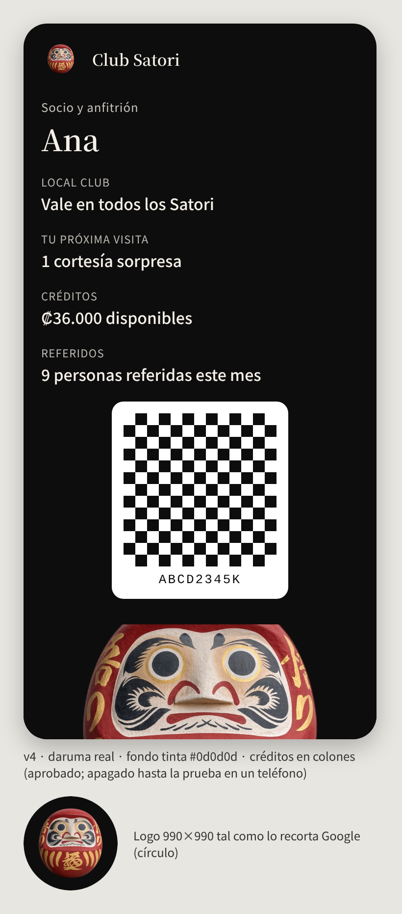

# Diseño del pase de Google Wallet — **v4 APROBADA (08-nov), APAGADA hasta la prueba en un teléfono**

> **Decisiones de Ismael (08-nov):** fondo **tinta `#0d0d0d`**; el daruma es la **imagen final de Ismael** (hecha a partir
> de una foto del daruma real; se puede publicar), sin filtros ni retoques de estilo. El daruma dibujado (v3) y la
> variante roja se borraron. **El pase sigue apagado** hasta que Ismael tenga la cuenta de Google Wallet y lo probemos en
> un teléfono: hasta entonces `WALLET_DISENO` no se carga.

- **Logo** (990×990, `club-web/public/pase/logo.png`): el daruma entero, centrado en un círculo tinta (Google muestra el
  logo en círculo); fuera del círculo, transparente.
- **Franja** (`heroImage`, 1032×336, `club-web/public/pase/hero.png`): la cara del daruma sobre tinta.
- **Texto del socio:** «Vale en todos los Satori» (Club compartido), sin lista de promociones.
- **Créditos del anfitrión** (Ismael, 08-nov): el saldo en colones, «₡36.000 disponibles» / «₡36,000 available», y
  si suma, en otra línea, «9 personas referidas este mes» / «9 guests referred this month». Ya no «2 · 14 personas».
- **De dónde salen:** `docs/club-satori/img/daruma/` guarda el original sin tocar y los scripts (`daruma_assets.py`: solo
  recorta el fondo blanco, escala y compone sobre tinta). La maqueta se regenera con
  `node docs/club-satori/img/pase-render.mjs` desde la raíz del repo.

| Pieza | Archivo | URL pública cuando se publique club-web |
|---|---|---|
| Logo | `club-web/public/pase/logo.png` | `https://club.satoricostarica.com/pase/logo.png` |
| Franja | `club-web/public/pase/hero.png` | `https://club.satoricostarica.com/pase/hero.png` |

## Cómo se enciende (después de la prueba en un teléfono y el OK de Ismael)
- En el Edge `club-pase`, secreto/variable
  `WALLET_DISENO = {"colorFondo":"#0d0d0d","logoUrl":"https://club.satoricostarica.com/pase/logo.png","heroUrl":"https://club.satoricostarica.com/pase/hero.png"}`
- Es la constante `DISENO_PROPUESTO` de `src/shared/wallet/googlePase.ts`.
- Antes: publicar club-web (las imágenes tienen que estar en línea) y probar «Guardar en Google Wallet» en un teléfono
  real con la cuenta de emisor de Ismael.
