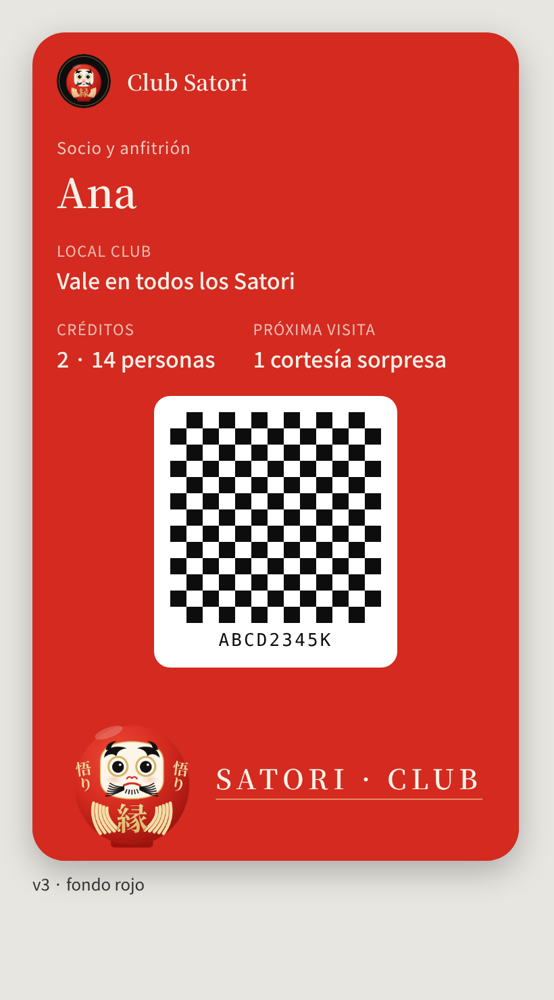

# Propuesta · diseño del pase de Google Wallet — **maqueta v3 (08-nov), APAGADA hasta el OK de Ismael**

> **v3 (08-nov):** el **daruma** de Ismael (PDF + captura), dibujado como imagen propia (`img/daruma.mjs` → PNG sin
> fondo): cuerpo rojo vivo, cara blanca, ojos con aro dorado, cejas y barba negras, **悟り** a los costados y **縁** dorado
> al centro. Franja «SATORI · CLUB». El 里 sale de todos lados (también del encabezado y el favicon de club-web).
> Hasta el OK, `WALLET_DISENO` no se carga y el pase sale solo con el fondo `#0d0d0d`.

**Fondo: recomiendo que siga TINTA `#0d0d0d`.** El daruma es rojo: sobre fondo rojo el cuerpo se funde con el fondo y se
pierde la silueta (ver la maqueta roja); sobre tinta, el rojo, el blanco de la cara y el oro resaltan, y queda igual que
el encabezado de club-web y de la app.

| Tinta (recomendado) | Rojo |
|---|---|
|  |  |

- **Logo** (660×660, `club-web/public/pase/logo.png`): el daruma sin los kanji de los costados (se lee chico), sobre un
  círculo tinta con filete dorado.
- **Franja** (`heroImage`, 1032×336, `club-web/public/pase/hero.png`; la variante roja en `hero-rojo.png`): el daruma
  completo + «SATORI · CLUB».
- **Texto del socio:** «Vale en todos los Satori» (Club compartido), sin lista de promociones.
- Se regeneran con `docs/club-satori/img/pase-render.mjs` (Playwright + Google Fonts).

| Pieza | Archivo | URL pública cuando se publique club-web |
|---|---|---|
| Logo | `club-web/public/pase/logo.png` | `https://club.satoricostarica.com/pase/logo.png` |
| Franja | `club-web/public/pase/hero.png` | `https://club.satoricostarica.com/pase/hero.png` |

## Cómo se enciende (después de aprobar)
- En el Edge `club-pase`, secreto/variable
  `WALLET_DISENO = {"colorFondo":"#0d0d0d","logoUrl":"https://club.satoricostarica.com/pase/logo.png","heroUrl":"https://club.satoricostarica.com/pase/hero.png"}`
  (con fondo rojo: `"colorFondo":"#d42a1f"` y `hero-rojo.png`).
- Es la constante `DISENO_PROPUESTO` de `src/shared/wallet/googlePase.ts`.
