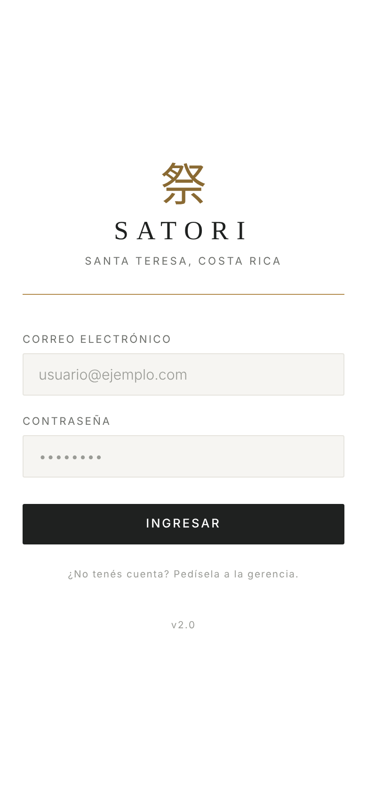
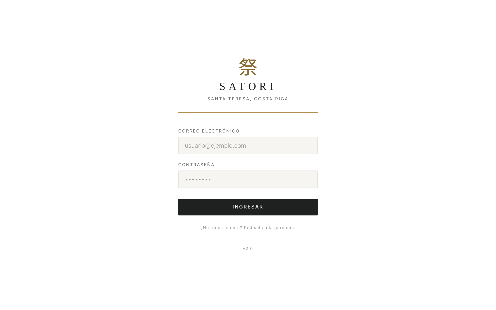

# Reporte · Línea B · B2 · Valores del diseño C

- **PR:** [#112](https://github.com/CachoSatori/satori-app/pull/112) → `staging` (rama `claude/rediseno-B2`). Sin mergear.
- **Archivo tocado:** solo `src/index.css`.

## Qué se hizo
- **Colores.** El `:root` único lleva los valores del diseño C:
  - fondo `#ffffff`, tinta `#1f2120`, gris `#6e706c` y `#9a9b96`;
  - línea `#e6e4de`, panel `#f6f5f2`;
  - oro `#b48e50` y oro para texto `#8a6a33`;
  - laca `#a3392d` sobre `#f6e4e1`, musgo `#3e6a4c` sobre `#e6efe8`;
  - nuevo `--c-oro-fondo` (`#f4f0e6`) para «pendiente».
- **Variables unificadas.** Sobre las dudas de B1:
  - `--c-negro` y `--c-blanco` se eliminaron;
  - `--c-error` es alias de la laca y `--c-exito` del musgo;
  - `--c-papel` (el crema de los módulos) pasa a blanco.
- **Alias del shell viejo, a tema claro:**
  - `--black` es el fondo blanco;
  - `--white` es la tinta;
  - `--gray-dark` es el panel;
  - `--accent` es el oro para texto.

  Con eso, el login, el encabezado y el Inicio quedan con fondo blanco y el botón principal en tinta.
- **Tipografía:**
  - Cormorant Garamond (500 y 600) en `--font-serif`, con Noto Serif JP de respaldo para los kanji;
  - DM Sans (400, 500 y 600) en `--font-sans`;
  - `tabular-nums` en `body`;
  - las 39 apariciones de `'DM Mono', monospace` pasan a `var(--font-mono)`, que apunta a DM Sans.
- **Filetes de oro:** bajo el encabezado de la app, bajo `.module-header` (que pasa a fondo blanco) y debajo de la marca del login.
- **Grises oscuros sueltos del shell:** 24 pasaron a `--c-linea` y `--c-panel`. Están en el login, el encabezado, el Inicio y los formularios viejos.
- **Los `rgba()` del oro y del rojo viejos** pasan a los tonos nuevos.

## Gates
| Gate | Resultado |
|---|---|
| `VITE_APP_ENV=production npm run build` | ✅ |
| `npm test` (variables ficticias) | ✅ 158 archivos pasan · 2 omitidos · 1 ❌ conocido (`pos-bridge/backfill.test.ts`, `mssql`) · 2239 tests pasan |
| `grep` de diagnósticos en `dist/` | ✅ vacío |
| diff de `cashUtils.ts` / `tipCalculations.ts` | ✅ vacío |

## Capturas (build local, login, sin datos)
Celular (390 px) y computadora (1280 px):

 

> En el entorno de la línea, Google Fonts está bloqueado. Por eso las capturas muestran la letra de respaldo y no Cormorant ni DM Sans. En staging se van a ver las fuentes reales.

## Qué va a ver el encargado
- **Login:** pantalla blanca. Arriba, el kanji en oro y «SATORI»; debajo, un filete de oro. Los campos van en gris muy claro y el botón «Ingresar», negro con letra blanca.
- **Inicio y encabezado:** fondo blanco con líneas finas grises y un filete de oro bajo el encabezado. Los nombres de los módulos van en tinta.
- **Módulos (Caja, Propinas, Ventas, SoP, Resumen):** el cuerpo pasa de crema a blanco. Las barras de arriba de cada módulo siguen oscuras (tinta). Los colores de alerta y de bien son un poco más sobrios.
- **Números:** en la misma letra que el resto, con cifras alineadas. Ya no en máquina de escribir.

## Dudas y riesgos (para la validación visual)
- **Admin → Empleados (línea A):** `EmployeeList.tsx:207` tiene un selector con fondo `#111` fijo y color `var(--white)`, que ahora es tinta, así que queda **texto oscuro sobre fondo oscuro**. Se arregla en el componente: es archivo de la línea A y no se tocó.
- **Estilos en línea:** 24 componentes tienen fondos oscuros fijos en `style={{…}}`. No se ven desde el CSS. Hay que revisarlos en staging: son sobre todo barras de Ventas y Caja, que siguen oscuras y no deberían cambiar.
- **Barras oscuras de módulo:** se dejaron en tinta a propósito, porque pasarlas a blanco cambia colores de texto de componentes. Si se quieren blancas, es una tarea aparte.
- **Colores sueltos:** siguen 306 hex en el resto de la hoja, la mayoría `#fff`, `#888` y grises. No se tocaron fuera del shell.
- No se suscribió la sesión al PR: según el PROTOCOLO, los `cambios pedidos` los toma la próxima corrida de la línea B.
