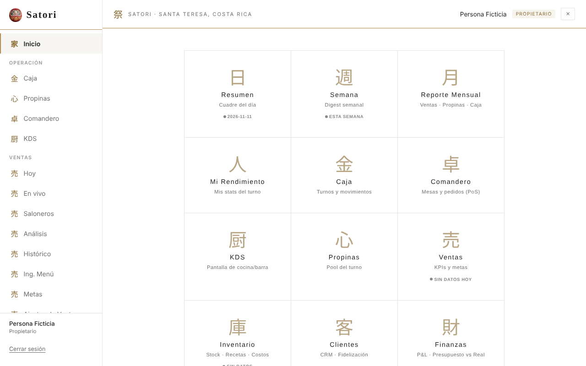
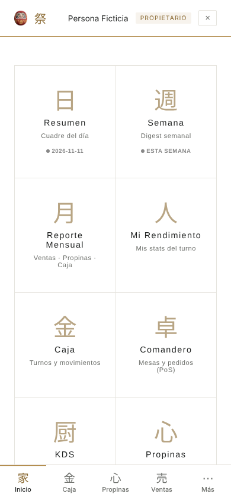
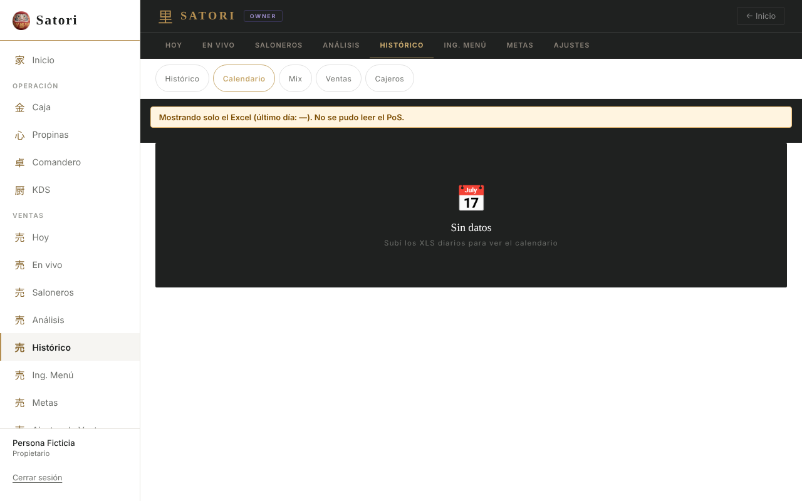
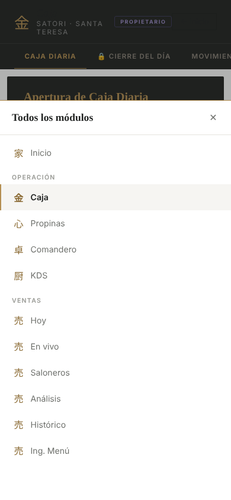
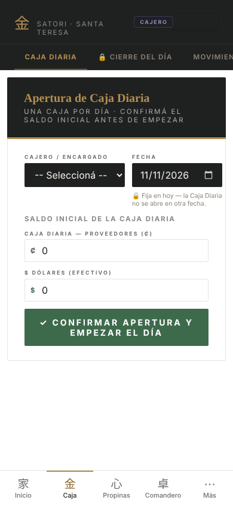
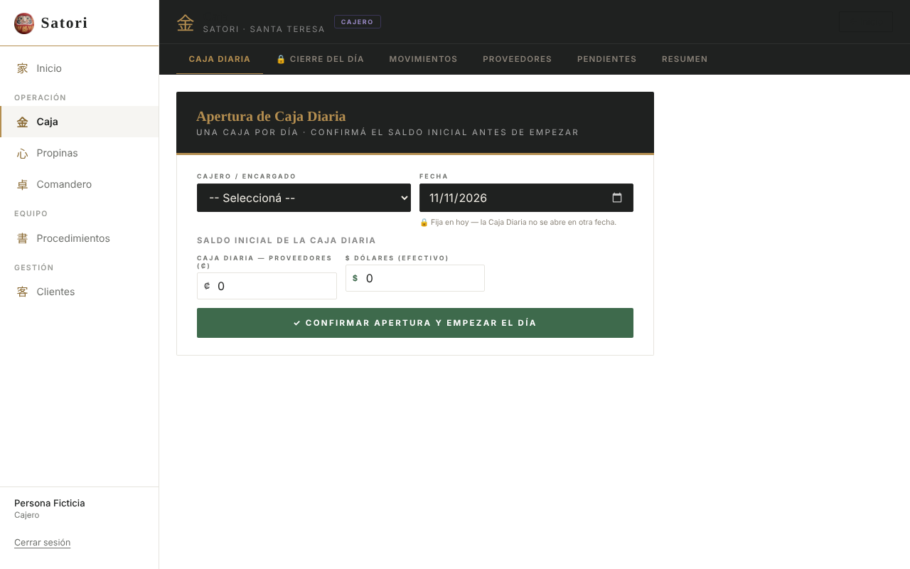
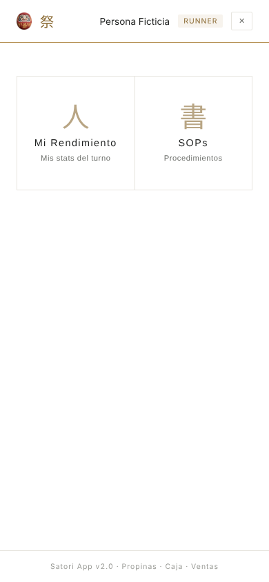

# Reporte · Línea B · B3 · Shell: menú lateral y barra inferior

- **PR:** [#114](https://github.com/CachoSatori/satori-app/pull/114) → `staging` (rama `claude/rediseno-B3`). Sin mergear.
- **Vista previa:** `claude-rediseno-b3.satori-staging.pages.dev`.
- **Archivos:** todos de la línea B.
  - `src/App.tsx`, `src/pages/HomePage.tsx` y `src/index.css`;
  - `src/shared/layout/**` (nuevo): `modulos.ts`, `AppShell.tsx`, `AppShell.css`, `useMenuVisible.ts` y dos tests;
  - `public/marca/daruma.png`;
  - la guía 6.1 e `INVENTARIO.md`.

## Qué se hizo
- **Una sola fuente.** `MODULES` salió de `HomePage.tsx` y pasó a `src/shared/layout/modulos.ts`, con un campo `grupo`. Los `roles` no cambiaron: la grilla del Inicio y el menú salen del mismo filtro.
- **Menú lateral** (desde 1024 px):
  - arriba, el Daruma y «Satori», con un filete de oro;
  - después, «Inicio» y los grupos Operación, Ventas, Equipo, Gestión y Ajustes;
  - abajo, el nombre, el rol y «Cerrar sesión».
- **Barra inferior** (debajo de 1024 px): «Inicio» y los módulos más usados del rol, con 5 botones como máximo. Si no entran todos, el quinto es «Más», que abre la hoja «Todos los módulos» con el menú completo. Botones de 44 px como mínimo.
- **Sin menú:**
  - quien tiene 3 módulos o menos (barback, runner, cocina y proveedor);
  - `/login` y `/registro`;
  - una cuenta deshabilitada;
  - el cambio de contraseña pendiente.
- **Ventas:**
  - en el menú lateral y en «Más» aparece con sus entradas de A2, que llevan a `/ventas?tab=<primera vista visible de la entrada>`;
  - el filtro por rol es el mismo de `ventasTabs.ts`, que se lee y no se toca;
  - en la barra inferior, «Ventas» abre `/ventas` con la pestaña de arranque de siempre.
- **El botón 🏠 flotante** se oculta cuando hay menú.
- **No cambian:** las rutas, `PrivateRoute`, `OwnerRoute` ni el aterrizaje del cajero.

## Gates
| Gate | Resultado |
|---|---|
| `VITE_APP_ENV=production npm run build` | ✅ |
| `npm test` (variables ficticias) | ✅ 162 archivos pasan · 2 omitidos · 1 ❌ conocido (`pos-bridge/backfill.test.ts`, `mssql`) · 2323 tests pasan |
| `grep` de diagnósticos en `dist/` | ✅ vacío |
| diff de `cashUtils.ts` / `tipCalculations.ts` | ✅ vacío |
| `.insert/.update/.delete/.upsert/.rpc(` agregados | ✅ ninguno |
| `eslint` y `tsc` de los archivos tocados | ✅ |

**Aceptación.** `modulos.test.ts` fija a mano la grilla de cada rol, tal como estaba en `HomePage.tsx` en `a0e959b`. Comprueba dos cosas por rol:
- la grilla es la misma, con el mismo orden;
- el menú muestra exactamente esos módulos, ni uno más ni uno menos.

`AppShell.render.test.tsx` lo prueba en el DOM:
- los grupos y la entrada activa por `?tab=`;
- la barra del cajero con «Más»;
- que no hay menú para los roles chicos, para una cuenta deshabilitada ni en `/login`.

## Capturas (build local, backend simulado, usuario ficticio)
- **Owner en Inicio:** en computadora, con el menú lateral, y en celular, con la barra.

   
- **Owner en Ventas › Histórico › Calendario:** la entrada activa queda marcada en el menú.

  
- **Hoja «Más» en el celular:** el owner, parado en Caja.

  
- **Cajero en Caja:** en celular y en computadora.

   
- **Runner:** tiene 2 módulos, así que no lleva menú y sigue con el botón 🏠.

  

> Google Fonts está bloqueado en el entorno de la línea, así que las capturas muestran la letra de respaldo.

## Qué va a ver el encargado
- **En la compu:** a la izquierda, un menú blanco fijo. Arriba, el Daruma y «Satori»; debajo, Inicio, Operación (Caja, Propinas, Comandero, KDS), Ventas (Hoy, En vivo, Saloneros, Análisis, Histórico, Ing. Menú, Metas, Ajustes de Ventas), Equipo (Mi Rendimiento, Procedimientos, Salarios) y Gestión (Resumen, Semana, Reporte Mensual, Finanzas, Inventario, Clientes). La pantalla en la que está queda marcada con una raya de oro.
- **En el celular:** abajo, una barra fija con «Inicio», «Caja», «Propinas», «Ventas» y «Más». «Más» abre la lista completa desde abajo.
- **El botón 🏠 redondo ya no aparece:** «Inicio» está en el menú.
- **Las pantallas de los módulos son las mismas:** en la compu se corren a la derecha del menú.
- **Cajero:** al abrir la app sigue cayendo en Caja. Abajo ve «Inicio», «Caja», «Propinas», «Comandero» y «Más» (Clientes y Procedimientos).
- **Salonero:** ve «Inicio», «Mi Turno», «Mi Rendimiento», «Comandero» y «Procedimientos», sin «Más».
- **Barback, runner y cocina:** no cambian.

## Dudas y riesgos (para la validación visual)
- **Bandeja de facturas:** el PLAN la pone en Operación, pero hoy no tiene tarjeta en el Inicio, y la aceptación pide el mismo conjunto que la grilla. **No se agregó.** Sumarla es un cambio de una línea en `modulos.ts`, con su test. Necesita el OK de Ismael, porque cambia lo que ve el cajero y el contador.
- **Comandero y KDS:** el PLAN los descarta del rediseño, pero están en la grilla de staging. Quedaron en Operación, porque sacarlos rompía «exactamente los de la grilla». Si se quieren afuera del menú, hay que decidirlo.
- **«Más» del contador:** tiene 8 módulos. En la barra van Caja, Propinas y Ventas, y el resto queda en «Más».
- **Superposiciones en el celular:**
  - la franja de «SIN CONEXIÓN» (`OfflineBanner`, archivo prohibido) aparece **encima** de la barra inferior mientras dura;
  - los botones fijos abajo que tengan los módulos van a quedar tapados por la barra; hoy no se vio ninguno.

  El contenido lleva un margen inferior igual al alto de la barra, en la variable `--shell-barra-alto`, para que lo usen después.
- **Encabezados de los módulos:** siguen oscuros y con su propio «← Inicio». En la compu quedan dos caminos a Inicio. Sacar esos botones es trabajo de cada módulo (línea A).
- **Banner de STAGING:** es fijo arriba, así que en staging tapa unos 20 px de la marca del menú. En producción no existe.
- **`HomePage.tsx`:** solo cambia de dónde lee `MODULES` y suma el Daruma en el encabezado del celular. El rediseño del Inicio es B4.
