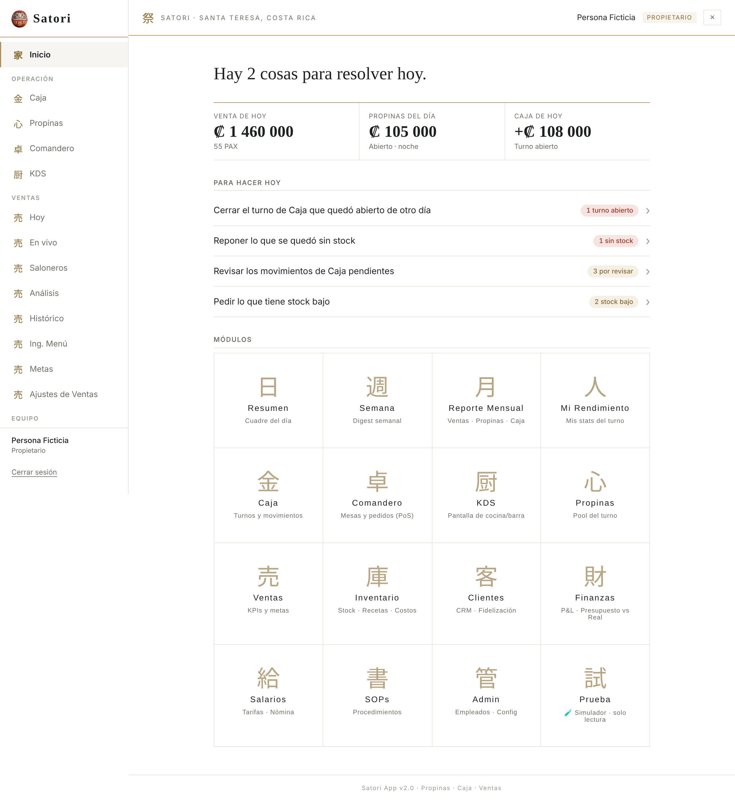
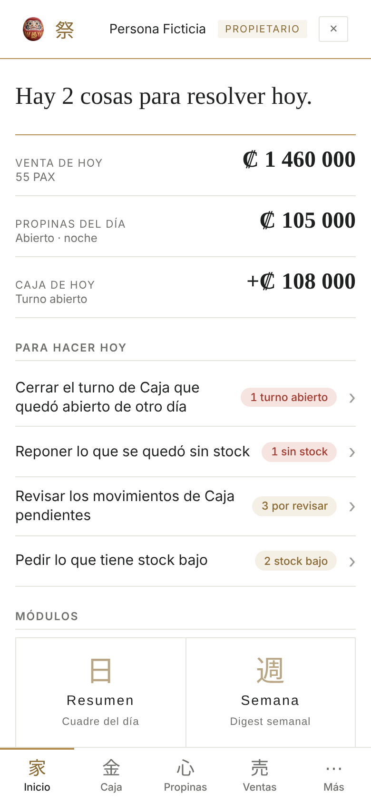
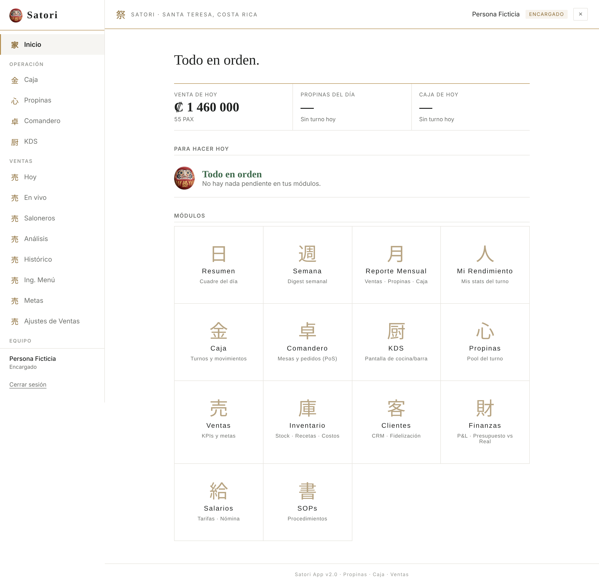
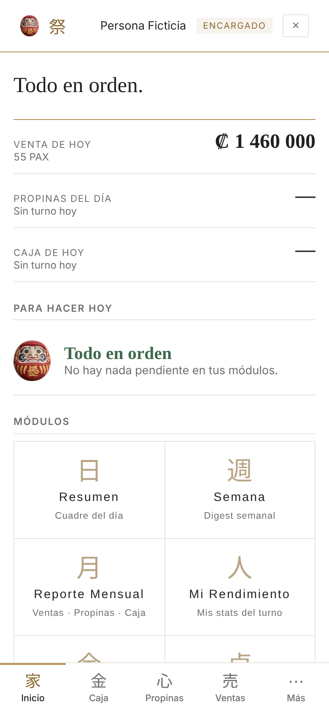
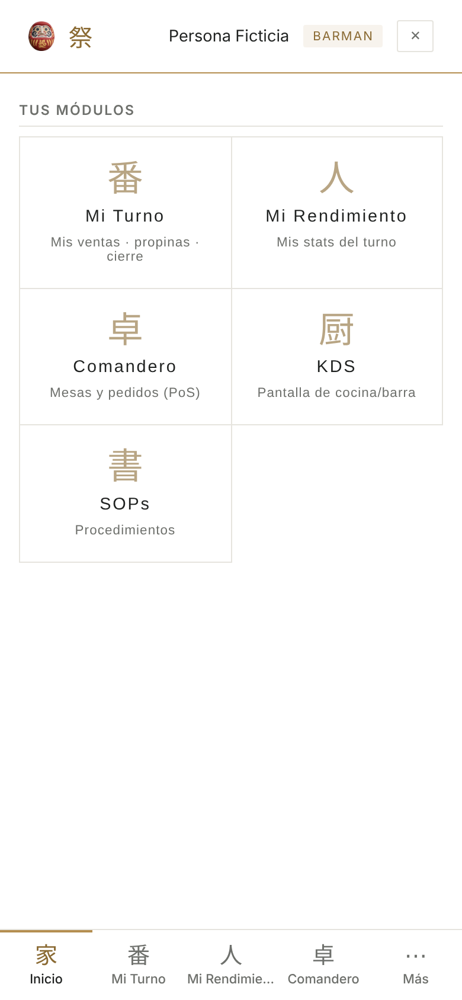

# Reporte · Línea B · B4 · Inicio con pendientes

- **PR:** [#115](https://github.com/CachoSatori/satori-app/pull/115) → `staging` (rama `claude/rediseno-b4`). Sin mergear.
- **Vista previa:** `claude-rediseno-b4.satori-staging.pages.dev`.
- **Archivos:** todos de la línea B.
  - `src/pages/HomePage.tsx` y `src/index.css`;
  - `src/shared/layout/pendientes.ts` (nuevo) y su test;
  - `src/pages/HomePage.render.test.tsx` (nuevo);
  - la guía 6.1 (con `verificado_en_commit`) e `INVENTARIO.md`.

## Qué se hizo
- **Inicio de owner, manager y contador**, arriba de la grilla:
  1. una frase con la conclusión: «Todo en orden.», «Queda un pendiente para hoy.», «Quedan N pendientes para hoy.», «Hay una cosa / N cosas para resolver hoy.»;
  2. **3 números del día**, separados por filetes, sin tarjetas: «Venta de hoy» (con PAX y «meta del mes N %»), «Propinas del día» (abierto, cerrado y cuántas personas, o sin turno) y «Caja de hoy» (saldo de los movimientos de hoy y si el turno está abierto o cerrado);
  3. **«Para hacer hoy»**: lista con líneas finas y una píldora por renglón (laca = resolver, oro = pendiente). Lo malo va primero. Cada renglón abre el módulo donde se resuelve;
  4. **«Todo en orden»** con el Daruma cuando no hay nada.
- **Pendientes posibles:** días sin cierre; turno de Caja de otro día abierto; Caja abierta hace 20 h o más; movimientos de Caja por revisar; Propinas abiertas hace 20 h o más; sin stock; stock bajo; «Revisar la semana» los lunes; procedimientos vacíos. Solo salen los de módulos que el rol ve.
- **Las tarjetas ya no llevan el estado debajo.** Esa información pasó a los números y a la lista. La grilla queda con bordes finos, sin sombra, y con tarjetas más bajas en celular.
- **Los demás roles** ven solo la grilla, con el título «Tus módulos». El aterrizaje del cajero no cambia.

## Datos (lectura nueva, anotada)
- `fetchHomeStatus` **no cambió**: los pendientes salen de las mismas señales que antes iban en las tarjetas.
- **Días sin cierre:** se calcula con `calcularAlertaCierres` (sin cambios), con las **mismas funciones de lectura** que ya usa Caja: `getCierresDia`, `getAllCashMovements`, `getCashSessions` y `getJornadasConVentas`. Mismo filtro de rol que en Caja (owner y manager). **Es una lectura nueva en el Inicio, bajo la RLS actual.** Si falla, el pendiente no sale y el resto se muestra igual.
- **Ninguna escritura.** Sagrados, `supabase/`, rutas, permisos, outbox y service worker sin tocar.

## Gates
| Gate | Resultado |
|---|---|
| `VITE_APP_ENV=production npm run build` (pipefail) | ✅ |
| `npm test` (variables ficticias) | ✅ 164 archivos pasan · 2 omitidos · 1 ❌ conocido (`pos-bridge/backfill.test.ts`, `mssql`) · 2336 tests pasan |
| `grep` de diagnósticos en `dist/` | ✅ vacío |
| diff de `cashUtils.ts` / `tipCalculations.ts` | ✅ vacío |
| `.insert/.update/.delete/.upsert/.rpc(` agregados | ✅ ninguno |
| `eslint` y `tsc` de los archivos tocados | ✅ |

**Aceptación.**
- `pendientes.test.ts` (9 tests): qué pendientes salen según los datos, el umbral de 20 h, que la Caja larga no se duplica con un turno viejo, lo malo primero, las señales sin cargar no generan nada y el filtro por rol (contador, cajero, runner).
- `HomePage.render.test.tsx` (4 tests, base simulada): «Todo en orden» con Daruma; lista con píldoras; el contador no carga la alerta de cierres; los roles de operación ven solo la grilla.
- Guía 6.1 actualizada, con la tabla de cada renglón, su píldora, cuándo sale y quién lo ve.

## Capturas (build local, backend simulado, usuario y montos ficticios)
- **Owner con pendientes**, en computadora y en celular:

   
- **Manager con todo en orden**, en computadora y en celular:

   
- **Barman:** solo la grilla.

  

> Google Fonts está bloqueado en el entorno de la línea: las capturas muestran la letra de respaldo.

## Qué va a ver el encargado
- Al abrir el Inicio, arriba, una frase grande: por ejemplo «Hay 2 cosas para resolver hoy.» o «Todo en orden.».
- Debajo, tres números: la venta de hoy, el pozo de propinas y el saldo de la caja de hoy. En celular van uno debajo del otro.
- Después, «Para hacer hoy»: por ejemplo «Revisar los movimientos de Caja pendientes · 3 por revisar». Tocar el renglón abre Caja.
- Si no hay nada, el Daruma con «Todo en orden».
- Más abajo, las mismas tarjetas de siempre, sin el estado chiquito que tenían debajo.

## Dudas y riesgos
- **Peso del Inicio para owner y manager:** la alerta de días sin cierre lee los movimientos de Caja de ~1000 días (la misma lectura que hace Caja al abrir; queda en caché y Caja la reusa). No traba la pantalla: la lista dice «Cargando…» hasta que llega. Si se nota lento en el local, se puede limitar la ventana; eso cambia una consulta y queda para decidir.
- **Contador:** no ve días sin cierre, igual que en Caja hoy. Si se quiere, es una línea, pero cambia lo que ve un rol.
- **«Acción principal del rol»** (mencionada en el `PLAN.md`, no en la cola): no se agregó un botón aparte; los renglones de «Para hacer hoy» cumplen ese papel. Si Ismael quiere un botón fijo abajo en celular, va en una tarea nueva.
- **Cajero y personal de salón:** no tienen frase ni pendientes (antes tampoco veían estados). Se podría sumar, por ejemplo, «movimientos por revisar» al cajero; decisión de producto.
- **Encabezado oscuro de los módulos y doble «Cerrar sesión» en la compu** (✕ arriba y en el menú): siguen como en B3.
