# Reporte · Línea B · B6 · Cáscara y clases de módulo con estilo carta

- **PR:** [#122](https://github.com/CachoSatori/satori-app/pull/122) → `staging` (rama `claude/rediseno-b6`). Sin mergear.
- **Vista previa:** `claude-rediseno-b6.satori-staging.pages.dev`.
- **Archivos:** todos de la línea B.
  - `src/index.css`, `src/shared/layout/AppShell.css`, `src/shared/layout/AppShell.tsx` y su test;
  - `src/App.tsx`, `src/pages/auth/CambiarPasswordInicial.tsx`, `src/shared/ErrorBoundary.tsx` (solo estilo);
  - `public/fonts/` (nuevo: 12 `woff2` y las 2 licencias OFL, 224 KB);
  - la guía 6.1 (`verificado_en_commit: bbc8a2c`) e `INVENTARIO.md`.

## Qué se hizo
- **Mayúsculas (201):** fuera las 93 `text-transform: uppercase` de `index.css` y la de `.shell-grupo-titulo`.
  - En esas reglas, el espaciado entre letras de `0.05em` o más pasa a `0.02em`: en minúscula, el espaciado ancho se lee mal.
  - La letra de menos de `0.72rem` sube a `0.72rem`: son 73 reglas, sobre todo etiquetas de KPI y cabeceras de tabla.
  - Las 17 pestañas y botones de esas reglas que no tenían alto llevan `min-height: 44px`.
- **Barras y paneles oscuros → blanco con filete de oro:**
  - **encabezados:** `.cd-module-header`, `.tips-header` y `.vt-module-header` (que también usa Inventario) pasan a fondo blanco con línea de oro abajo;
  - **pestañas:** `.cd-nav-tabs` y `.vt-nav-tabs` (que también usa Propinas) van en blanco con línea fina; la pestaña activa, en `--c-oro-texto`;
  - **fondo de Ventas e Inventario:** `.vt-module` pasa a blanco;
  - **paneles a `--c-panel`:** KPIs, barra de meta, cabeceras y pies de tabla, lista de productos, tarjetas del día de la semana, cabecera del mix, barra de pozo y de configuración de Propinas, encabezado de proveedor, total pendiente y resumen de Caja;
  - **colores de estado:** la fila de efectivo de Propinas va en musgo; el resultado del Resumen de Caja, en musgo o laca;
  - **activos:** los botones activos de rango, período, orden y saloneros quedan en blanco con borde de oro;
  - **entradas oscuras:** `.tips-input-dark`, `.tips-money-input` y `.date-filter` pasan a blanco con borde fino.
- **Botón principal en tinta:** `.tips-btn-primary` y `.cd-btn-primary` quedan en tinta con texto blanco, en vez de oro sobre tinta.
- **Botón secundario (204):** nueva clase `.login-btn.secundario`, con borde `--c-linea`, fondo transparente y texto tinta. Reemplaza `background: var(--gray-pale)` en los 3 archivos de la cola.
- **Hoja «Más» (202):**
  - lleva `aria-modal="true"`;
  - al abrir, el foco va a «Cerrar»;
  - Escape la cierra;
  - al cerrar, el foco vuelve a «Más».

  Hay dos tests nuevos en `AppShell.render.test.tsx`.
- **Aviso sin conexión (204):**
  - en `App.tsx`, un envoltorio con `display: contents` y la clase `offline-sobre-barra`, solo cuando hay menú;
  - en `AppShell.css`, por debajo de 1024 px, el aviso sube a la altura de la barra (`!important` para ganarle al estilo en línea).

  `src/shared/offline/` no se tocó.
- **Fuentes sin internet (206):**
  - Cormorant Garamond (500, 600 y 500 itálica) y DM Sans (400, 500 y 600) en `public/fonts/`, en latin y latin-ext (por el ₡), con `@font-face` y `unicode-range`;
  - sale el `@import` de Google para esas dos; queda solo para Noto Serif JP, como respaldo de los kanji;
  - el service worker no cambia: su `globPatterns` ya incluía `woff2`, así que las fuentes entran al precache.

  **Prueba:** en las capturas, Google Fonts está bloqueado y aun así se ve Cormorant. La versión anterior caía en la letra de respaldo.

## Gates
| Gate | Resultado |
|---|---|
| `VITE_APP_ENV=production npm run build` (pipefail) | ✅ |
| `npm test` (variables ficticias) | ✅ 167 archivos pasan · 2 omitidos · 1 ❌ conocido (`pos-bridge`, `mssql`) · 2388 tests pasan |
| `grep` de diagnósticos en `dist/` | ✅ vacío |
| diff de `cashUtils.ts` / `tipCalculations.ts` | ✅ vacío |
| `.insert/.update/.delete/.upsert/.rpc(` agregados | ✅ ninguno |
| `eslint` y `tsc` de los archivos tocados | ✅ |

## Capturas (build local, backend simulado, usuario ficticio, sin datos)
- **Login:**

  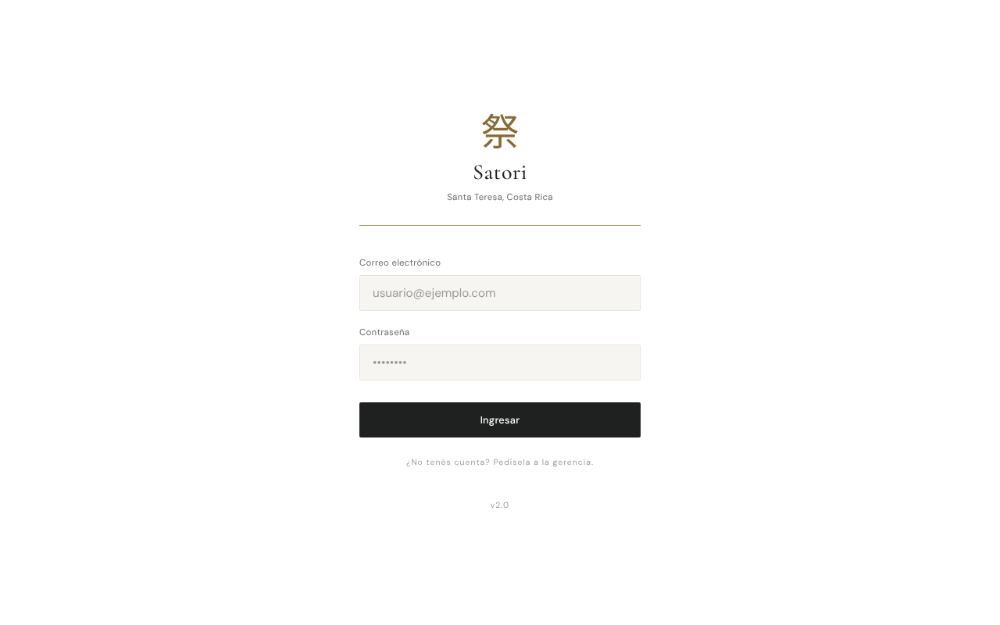 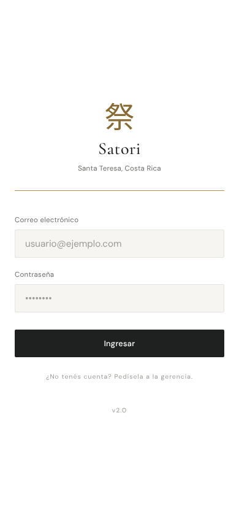
- **Inicio:**

  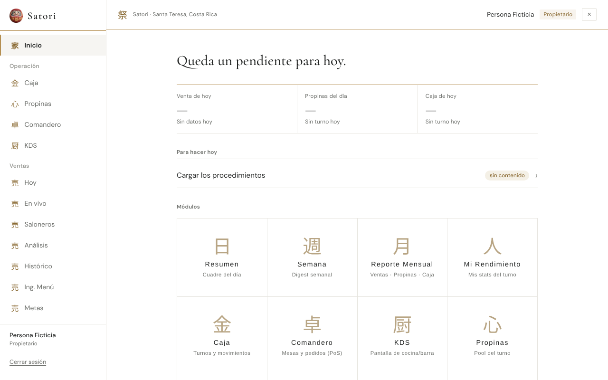 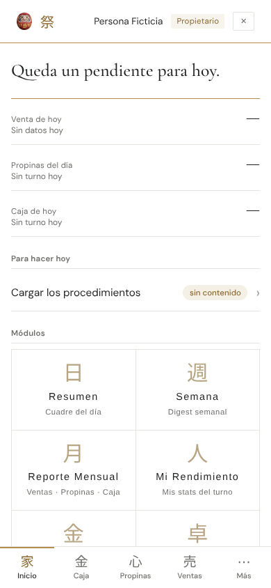
- **Ventas › Hoy:**

  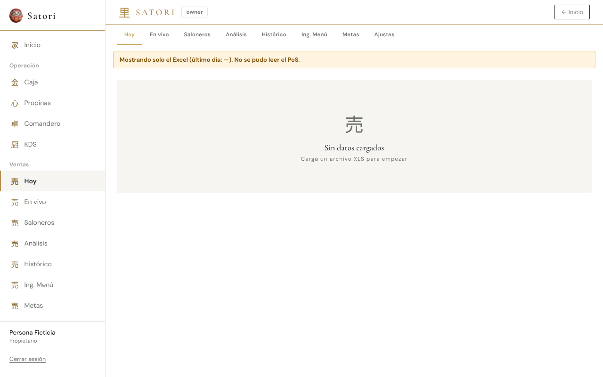 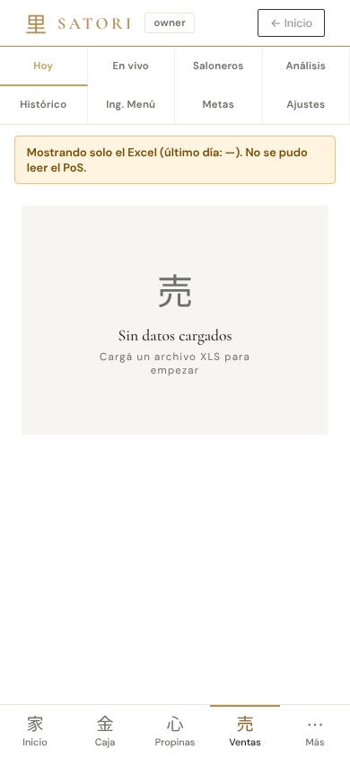
- **Caja › Caja Diaria:**

  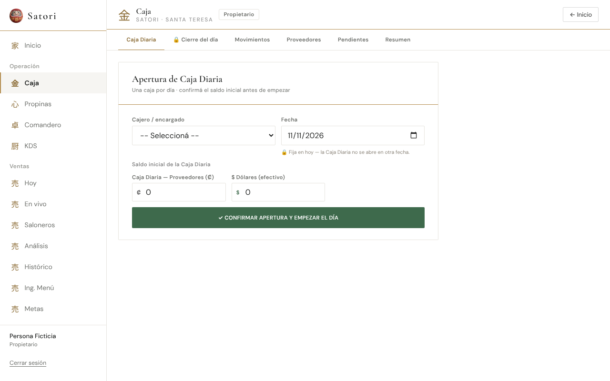 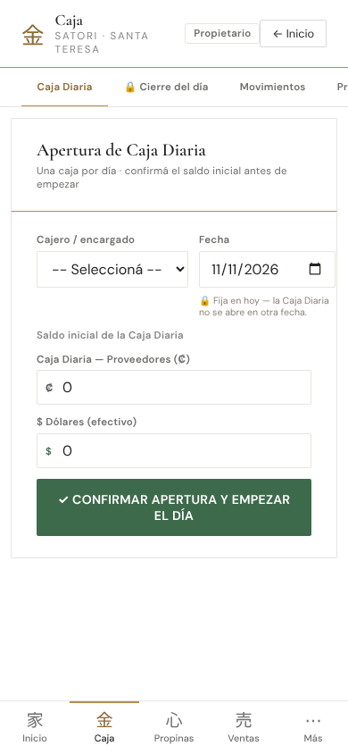
- **Propinas:**

  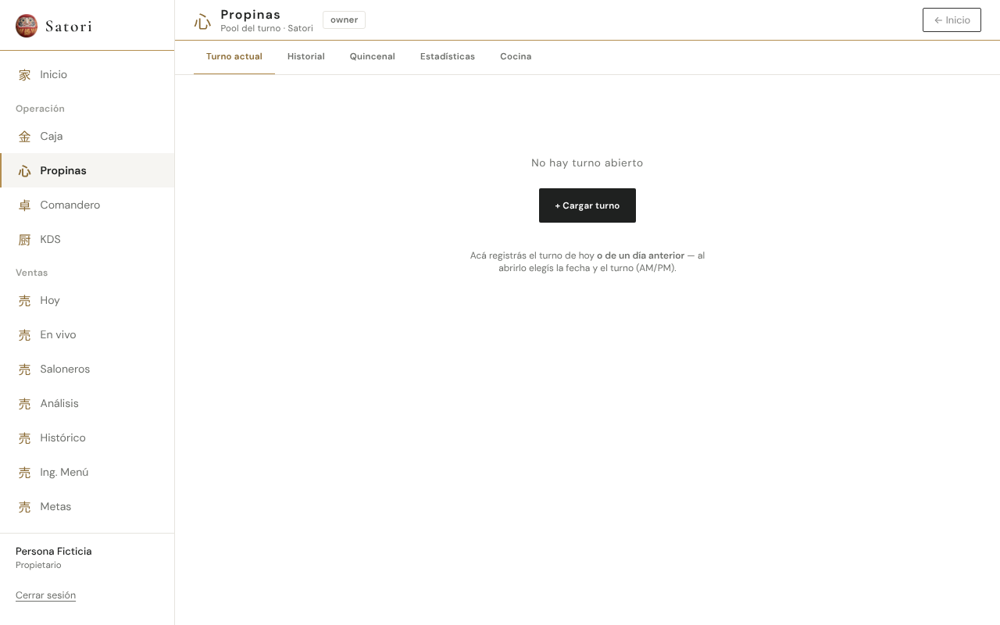 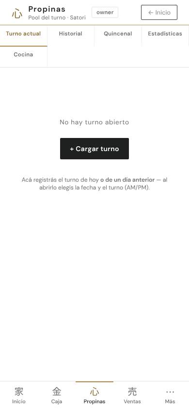
- **Hoja «Más»:**

  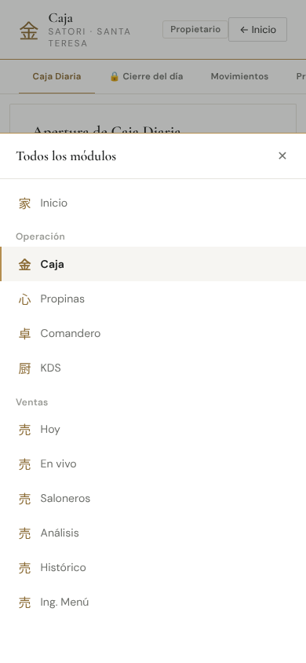

> El backend simulado no devuelve datos, así que las capturas muestran estados vacíos. KPIs, tablas, pozo de Propinas y resumen de Caja con datos se ven en la vista previa de staging.

## Qué va a ver el encargado
- **Caja, Propinas, Ventas e Inventario sin barra negra arriba:** encabezado blanco con una línea fina de oro, y las pestañas en minúscula normal, con la elegida en oro.
- **Las etiquetas chicas** («Venta de hoy», cabeceras de tabla, «Saldo inicial»…) ya no van en MAYÚSCULAS y son un poco más grandes.
- **En Ventas:** los recuadros de números (KPIs) van en gris muy claro con raya de oro a la izquierda, en vez de negros. Las cabeceras de tabla también van en gris claro.
- **En Propinas:** la barra del pozo y la fila de efectivo dejan de ser oscuras: el pozo va en gris claro y el efectivo en verde claro.
- **En Caja:** las tablas de Movimientos y los totales del Resumen pierden el negro.
- **«Cerrar sesión» de la pantalla de cuenta deshabilitada y «Ir al inicio» del error** pasan a botón con borde, sin relleno gris.
- **En el celular:**
  - el aviso «📡 SIN CONEXIÓN» aparece arriba de la barra de abajo, en vez de taparla;
  - «Más» se cierra también con Escape, si hay teclado.
- **Las letras se ven igual sin internet.**

## Dudas y riesgos
- **Quedan oscuros por estar fuera de la lista de B6:** `.resumen-*` (Resumen diario), `.sop-*` (Procedimientos), `.xr-current` (tipo de cambio en Admin), `.vt-eval-card` y `.vt-meta-proyeccion`.
  - **Por qué:** los dos últimos tienen adentro texto en línea con `var(--vt-paper)`, que es blanco, y quedaría blanco sobre blanco.
  - **Propuesta:** una B7 corta para esas clases, después de A7 y A10.
- **Paneles oscuros en línea** (`background: var(--vt-ink)` en Ventas, `TipQuincenal`, el modal de `TipHistory`): son de la línea A (A7–A9) y siguen oscuros hasta entonces. Se ven coherentes, oscuro con texto claro, pero mezclados con el resto blanco.
- **Activos en línea:** las pestañas de Ventas que tienen color de entrada en línea (`ENTRADA_COLOR`) mantienen ese color. Es de A7.
- **Mayúsculas que vienen del texto, no del CSS:** «CONFIRMAR APERTURA…» en Caja, «SATORI» en el encabezado de Ventas y la franja de STAGING. Son de línea A o a propósito.
- **Fuentes duplicadas en el precache (~120 KB):** Vite copia las fuentes de `latin` a `assets/` con hash y además sirve las de `public/fonts/`, así que el precache lleva las dos copias. Funciona igual. Si se quiere evitar, se mueven a `src/assets/fonts/`, pero eso cambia la ruta pedida en la cola.
- **`RegistroCliente.tsx`** (página pública del Club) conserva 2 `uppercase` en línea. No se tocó porque es del Club y no es Inicio ni menú.
