# Reporte · Línea B · B7 · Resumen, Admin, Inventario y Mi Rendimiento con estilo carta

- **PR:** [#124](https://github.com/CachoSatori/satori-app/pull/124) → `staging` (rama `claude/rediseno-b7`). Sin FIRMA. **Validación visual.** No mergeado.
- **Vista previa:** https://claude-rediseno-b7.satori-staging.pages.dev/resumen (y `/semana`, `/reporte-mensual`, `/admin`, `/inventario`, `/mi-rendimiento`)

## Qué se hizo
- **Estilos en línea** (20 archivos de `resumen/**`, `admin/**`, `inventario/**` y `ventas/MiRendimiento.tsx`), con un script por propiedad y después a mano:
  - ~500 hex y 23 `rgba` → `var(--c-*)` según el uso: texto gris → `--c-gris`; texto claro que iba sobre negro → `--c-tinta`; fondos oscuros → `--c-panel`; bordes → `--c-linea`; oros → `--c-oro-texto` (texto) o `--c-oro` (barras y filetes); verdes → `--c-musgo`; rojos → `--c-laca`; teal y azul a sus variables; fondos tenues → `--c-*-fondo` y bordes tenues → `--c-*-borde`;
  - las variables viejas (`--t-ink`, `--vt-paper`, `--vt-gold`…) también pasan a `--c-*` según el uso (el `rowColor` por defecto de la tabla de Ingredientes era `var(--vt-paper)`, que desde B2 es blanco: nombre y stock de los ingredientes normales salían **blanco sobre blanco**; ahora tinta);
  - `monospace`/`'DM Mono'` (40) → `var(--font-sans)` + `tabular-nums`; `textTransform: 'uppercase'` (35) fuera, con su `letterSpacing`;
  - botones principales verdes (Consumo, Recetas, Importar, Crear + vincular) → tinta con letra blanca; seleccionados de filtros (Horas trabajadas, PoS, Productos) → tinta con letra blanca; mesa elegida del editor de salón → borde oro sobre fondo oro claro;
  - `metaCol(...) + '22'` → `color-mix(in srgb, … 13%, transparent)`; título «INVENTARIO» → «Inventario» en Cormorant.
- **`index.css`:** el bloque `.resumen-*` seguía con tarjetas negras y letra blanca; pasa a blanco con filete de oro, píldoras de estado (`--c-*-fondo`) y cifras en Cormorant. `.xr-current` (tipo de cambio) deja el fondo negro; `.xr-*` y `.mr-*` sin hex sueltos.
- **Inventario:** las 4 copias locales de `fi` («₡ 1 460») → `fi()` compartido («₡1.460»). Solo texto en pantalla.
- **Guías:** 6.4 (Tarea 11, Resumen), 6.5 y 6.6 con una línea de aspecto; `verificado_en_commit: 80b2bcb`. `INVENTARIO.md` no cambia.
- **Chequeo de «solo estilo»:** comparé cada archivo contra `staging` con los literales de texto vaciados. Las únicas diferencias son claves de estilo (`fontVariantNumeric`, `minHeight`, sin `textTransform`/`letterSpacing`) y el import de `fi`. `rg "\.(insert|update|delete|upsert|rpc)\("` en el diff: nada.

## Gates
| Gate | Resultado |
|---|---|
| `set -o pipefail; VITE_APP_ENV=production npm run build` | ✅ exit 0 |
| `npm test` | ✅ 2394 pasan, 8 omitidos. Falla solo `pos-bridge/backfill.test.ts` (falta `mssql`; igual en `staging`) |
| `grep` de diagnósticos en `dist/` | ✅ vacío |
| `git diff origin/staging --stat` de `cashUtils.ts` y `tipCalculations.ts` | ✅ vacío |
| ESLint de los archivos tocados | ✅ 21 errores antes, 21 después |

## Capturas (build local, backend simulado, usuario y datos ficticios)
- **Resumen:** 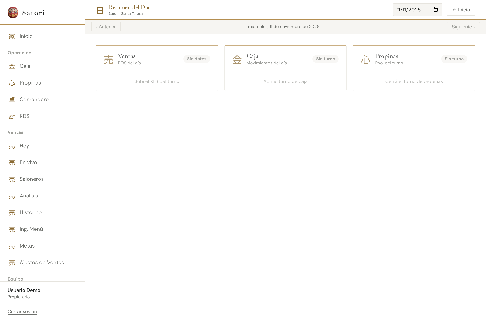 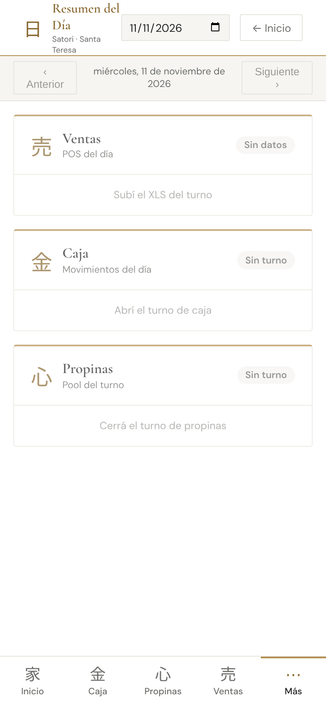
- **Semana:** 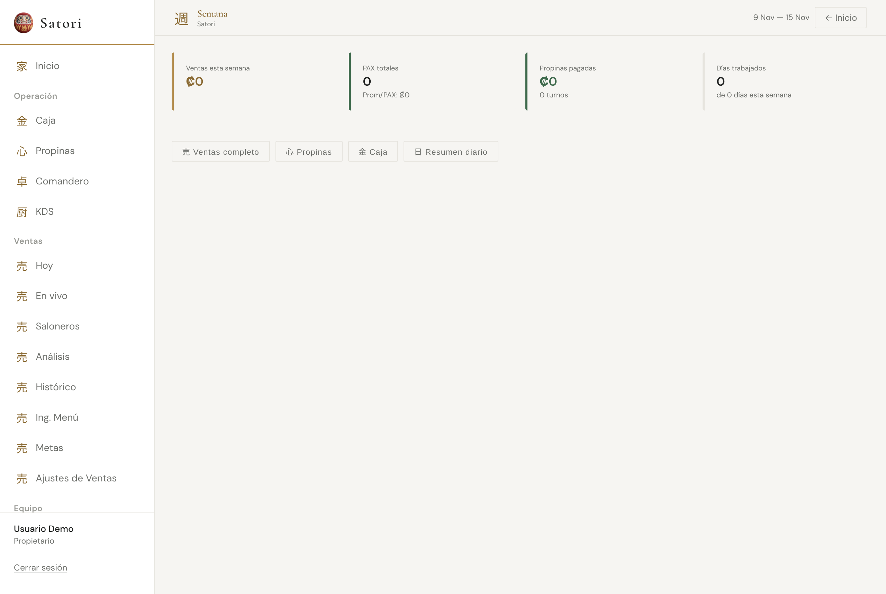 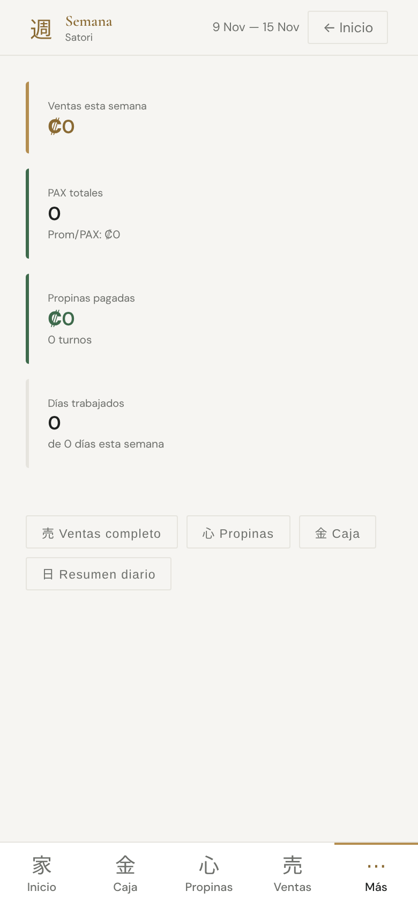
- **Reporte mensual:** 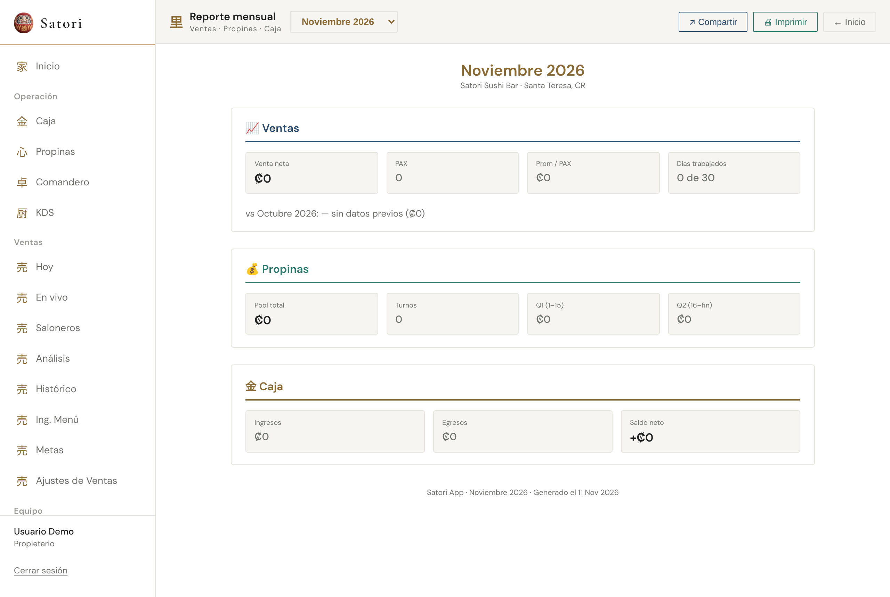 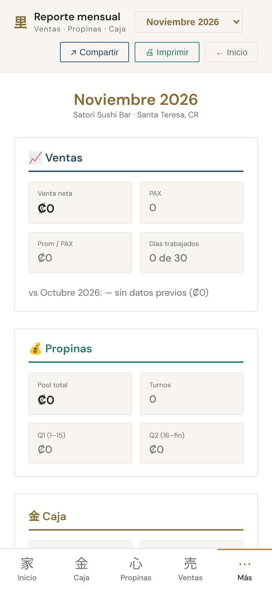
- **Admin:** 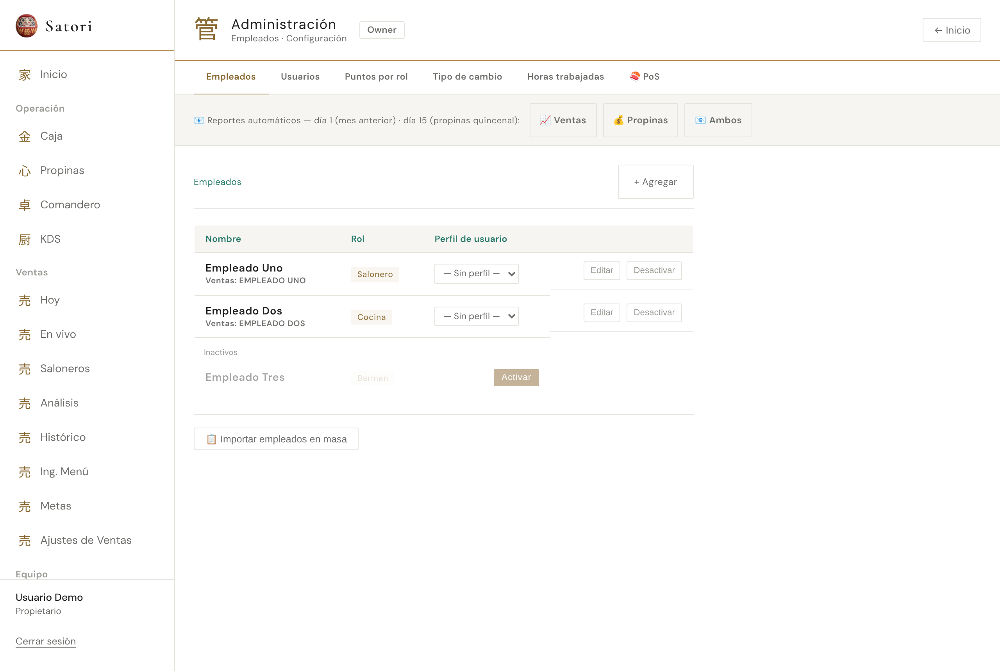 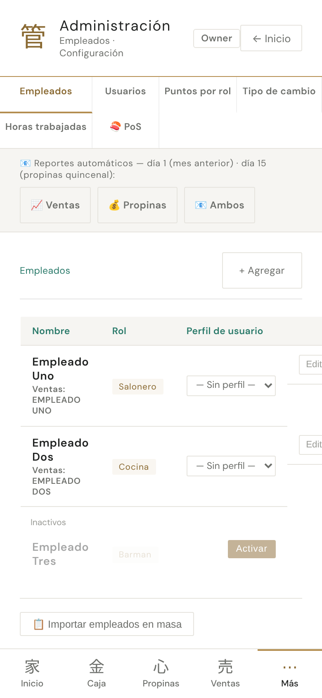
- **Inventario:** 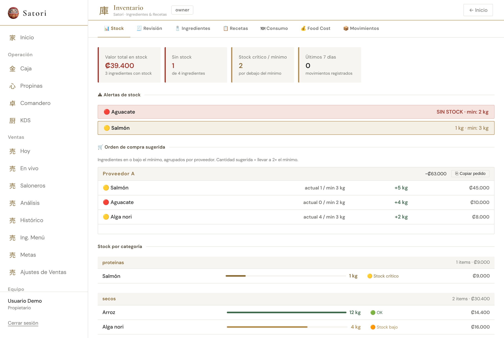 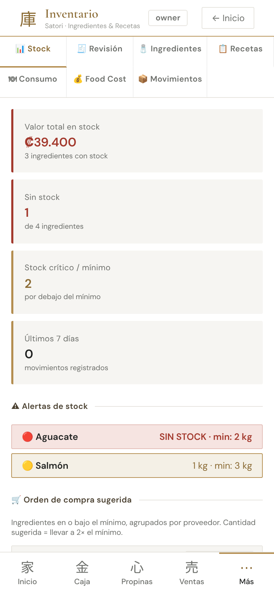
- **Mi Rendimiento:** 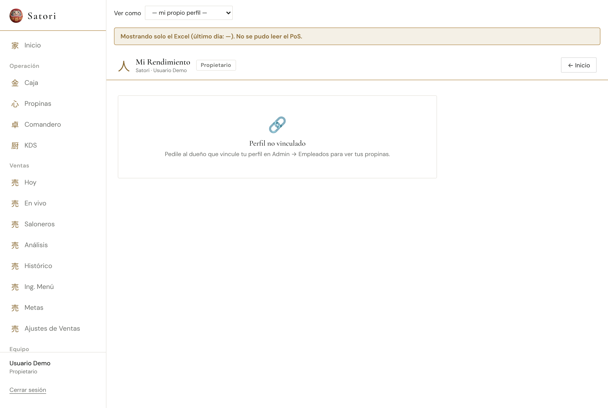 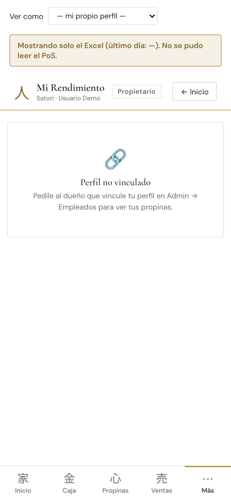

> Ventas, Caja y Propinas vienen vacíos (el simulado solo trae 4 ingredientes y 3 empleados ficticios). Mi Rendimiento sale «Perfil no vinculado». Las cifras reales se ven en la vista previa.

## Qué va a ver el encargado
- **Resumen del día:** las tres tarjetas (Ventas, Caja, Propinas) en blanco con una línea de oro arriba, en vez de negras; el estado es una píldora gris, oro o verde; las cifras en letra de título.
- **Semana y Reporte mensual:** sin mayúsculas forzadas; números alineados; verde y rojo más sobrios en las variaciones.
- **Admin:** tablas y etiquetas en tinta y gris; el botón elegido (Horas trabajadas, filtros del PoS y de productos) en negro con letra blanca; «Importar» y «Crear + vincular» en negro, ya no en verde.
- **Inventario:** el título dice «Inventario»; en la tabla de Ingredientes vuelven a verse el nombre y el stock de los que están bien (salían en blanco); los campos de los formularios pasan de negros a gris claro; alertas de stock en rojo y oro claros; montos como «₡39.400».
- **Mi Rendimiento:** mismas tarjetas y colores de meta (verde, oro, rojo), sin letra de máquina de escribir ni mayúsculas.

## Dudas
- **`vt-kpi red` en «Valor total en stock»:** el primer KPI de Inventario sale con filete y número en laca aunque no sea una alerta. Es la clase que pone el componente (`className`), no un estilo; no lo cambié porque sería decidir qué significa. Propuesta: pasarlo a la clase neutra en una tarea chica.
- **Píldora «📄 factura» de Movimientos** (`#6a4a8a` sobre `#efe6f8`, violeta) queda igual: no hay color del estilo carta para «origen». Suma a la paleta categórica que pidió A7 (`--c-serie-1…6`).
- **«Semana»** usa fondo panel en todo el cuerpo (clase `.vt-*` de B6) y los botones de abajo («Ventas completo», «Propinas»…) conservan un `letterSpacing` de clase. Se ve bien; lo dejo para una pasada de clases.
- **El color del texto «Copiar»** de Resumen quedó `copied ? musgo : musgo` (antes eran dos verdes distintos). La condición sigue ahí; es inocuo.
- Mientras B7 esté abierta, la línea A no toca estos módulos (excepción del PROTOCOLO). Al mergear, se puede devolver.
