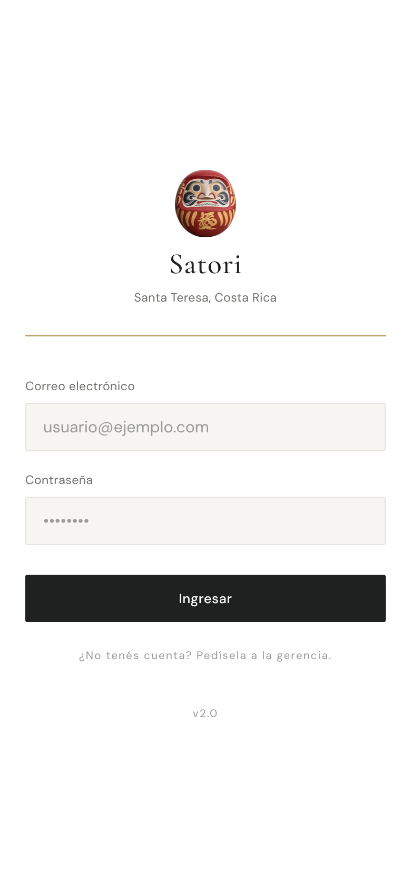
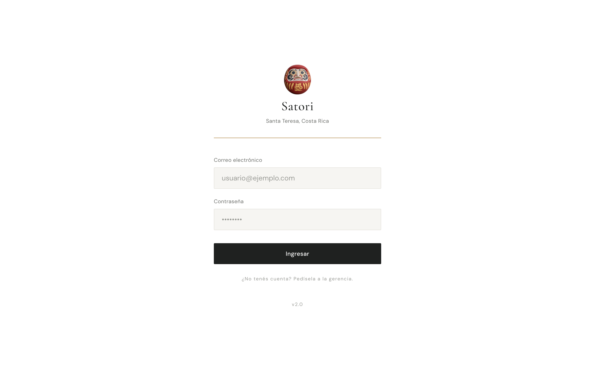
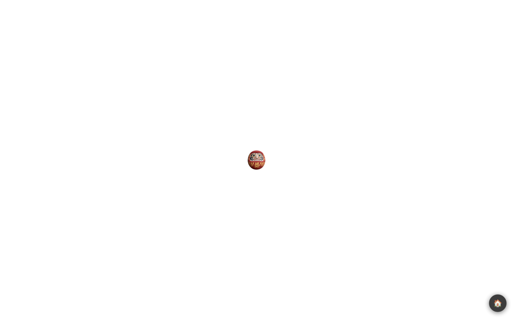
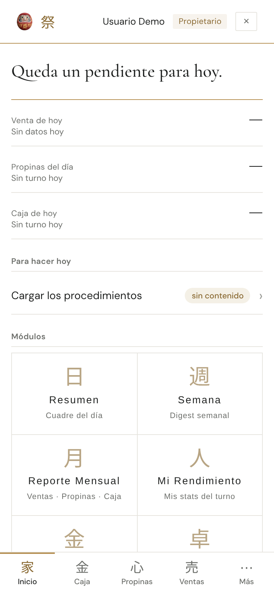
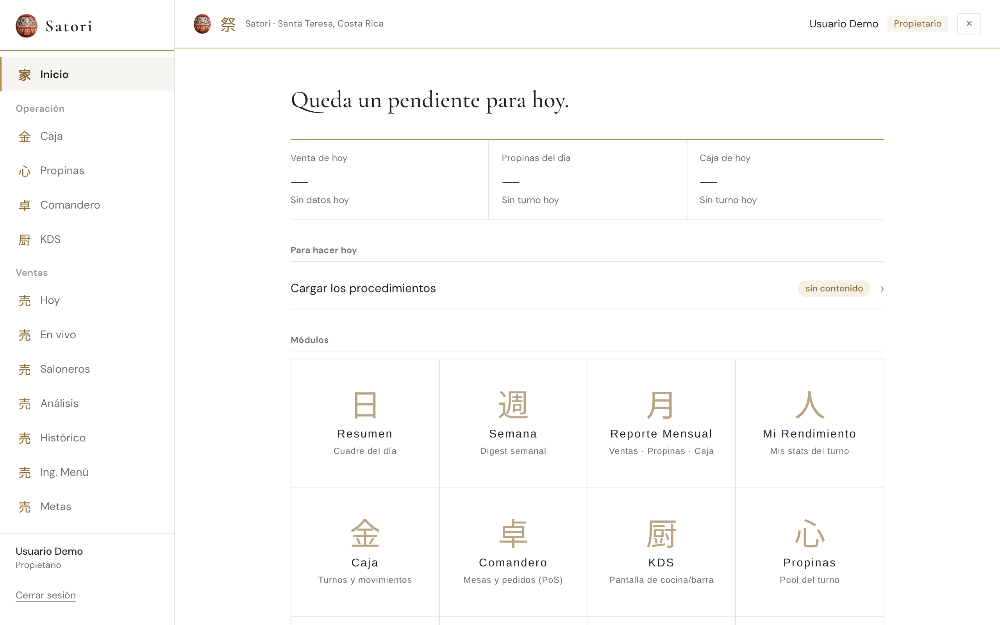
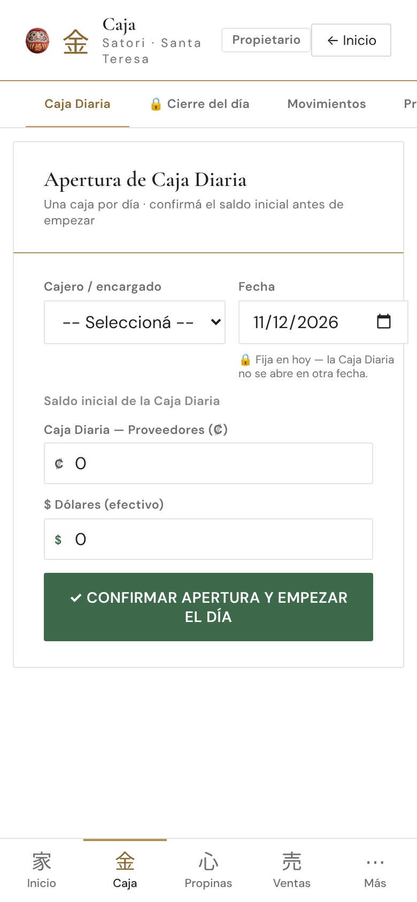
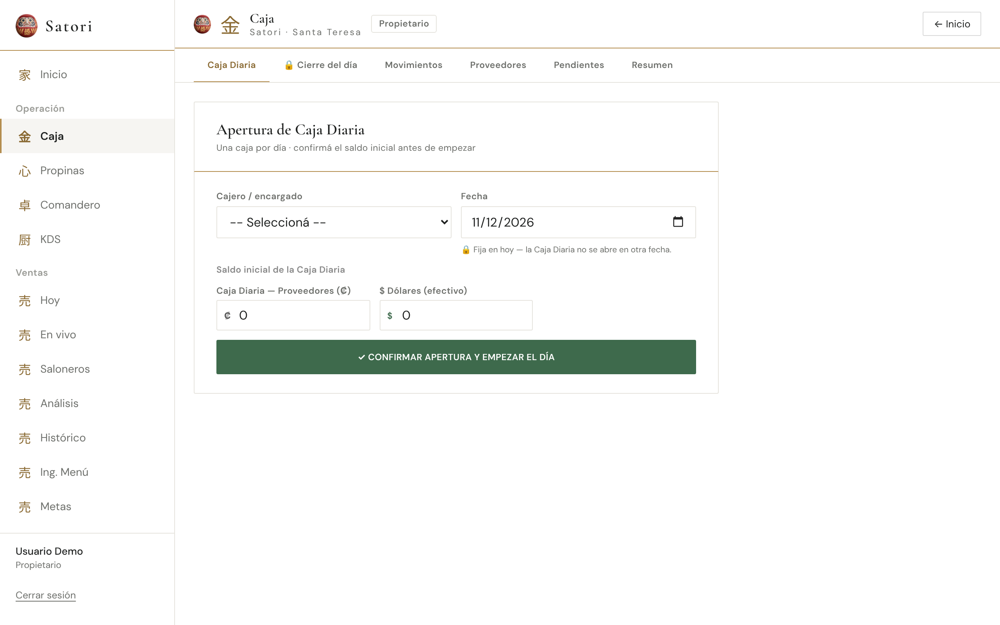
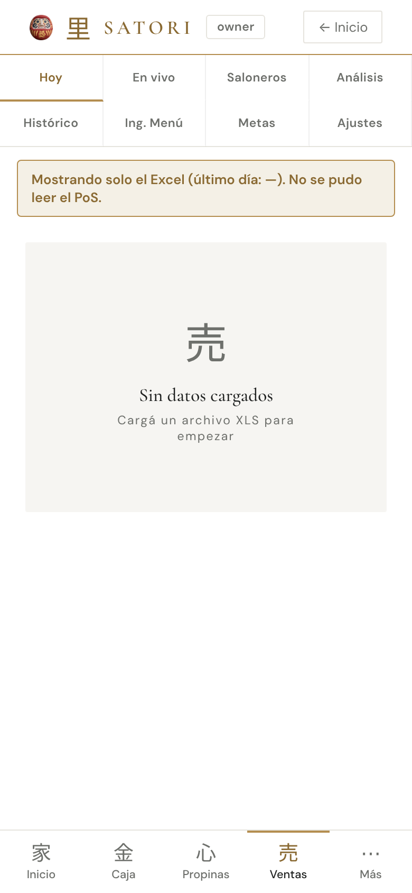
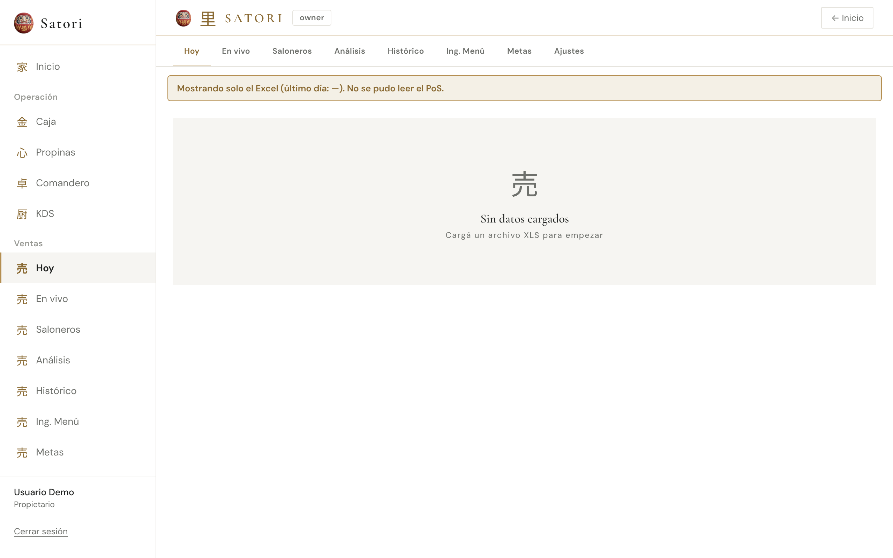

# Reporte · Línea B · B8 · Daruma en el login, en las cargas y en cada encabezado

- **PR:** [#130](https://github.com/CachoSatori/satori-app/pull/130) → `staging` (rama `claude/rediseno-b8`). Sin FIRMA. **Validación visual.** No mergeado.
- **Vista previa:** https://claude-rediseno-b8.satori-staging.pages.dev/login (y `/`, `/caja`, `/ventas`)

## Qué se hizo
- **Login** (`src/pages/auth/LoginPage.tsx`, 1 línea): el «祭» pasa a `` del Daruma (`${import.meta.env.BASE_URL}marca/daruma.png`, `alt=""`, 58 px, clase nueva `.login-daruma`). `CambiarPasswordInicial` conserva su «鍵».
- **Cargas** (`.loading-mark` en `src/index.css`): la letra sigue en el DOM pero no se ve (`text-indent` + `overflow: hidden` + `color: transparent`, también tapa el 📋 de Recetas); el Daruma va de fondo a 44×48 px y se mece lento (±5°, 2,6 s, eje abajo). Con `prefers-reduced-motion: reduce` queda quieto. Vale para el `Suspense` de `App.tsx` y los 13 módulos sin tocarlos. La animación vieja `pulse` queda definida pero sin uso.
- **Encabezados** (`::before` de 22×24 px, a la izquierda de la letra): `.module-header-left` (Admin), `.tips-header-left` (Propinas, Clientes, Finanzas), `.cd-module-header > :first-child` (Caja, Bandeja, Prueba, Mi Rendimiento), `.vt-module-header > :first-child` (Ventas, Inventario), `.resumen-header > :first-child` (Resumen) y `.sop-header > :first-child` (SOPs).
- **Inicio en computadora:** fuera el `display: none` de `.header-daruma` desde 1024 px; en computadora el Daruma se ve en la marca del menú y en el encabezado.
- **URL en producción:** en el build con base `/satori-app/`, el CSS queda `url(/satori-app/marca/daruma.png)` (2 apariciones en `dist/assets/index-*.css`). En las capturas (build de prod) carga bien.
- **Guía 6.1:** login con Daruma, Daruma de carga y en cada módulo, tabla de problemas («la pantalla queda en el Daruma de carga»). `verificado_en_commit` al commit del cambio.

## Gates
| Gate | Resultado |
|---|---|
| `set -o pipefail; VITE_APP_ENV=production npm run build` | ✅ exit 0 |
| `npm test` | ✅ 2394 pasan, 8 omitidos. Falla solo `pos-bridge/backfill.test.ts` (falta `mssql`; igual en `staging`). Corrido con `VITE_SUPABASE_URL`/`VITE_SUPABASE_ANON_KEY` ficticias: sin ellas, 5 suites más revientan al importar `supabase.ts` (clon fresco, igual en `staging`) |
| `grep` de diagnósticos en `dist/` | ✅ vacío |
| `git diff origin/staging --stat` de `cashUtils.ts` y `tipCalculations.ts` | ✅ vacío |
| Archivos del diff | `src/index.css`, `src/pages/auth/LoginPage.tsx`, guía 6.1. Ninguna consulta, condición, `onClick`, permiso ni ruta |

## Capturas (build local de prod + `vite preview`, backend simulado, usuario «Usuario Demo» ficticio, sin datos)
- **Login:**  
- **Carga** (Caja esperando la base):  
- **Inicio:**  
- **Caja:**  
- **Ventas:**  

## Qué va a ver el encargado
- **Al abrir la app:** el Daruma arriba del título «Satori», donde antes estaba el 祭.
- **Mientras carga un módulo:** el Daruma en el centro, balanceándose despacio, en vez de la letra que titilaba.
- **En cada pantalla** (Caja, Propinas, Ventas, Inventario, Admin, Bandeja, Clientes, Finanzas, Resumen, SOPs, Mi Rendimiento): un Daruma chico arriba a la izquierda, antes de la letra del módulo.
- **En el Inicio en computadora:** el Daruma también en la barra de arriba (además del menú).

## Dudas
- **Sin Daruma en el encabezado** porque no tienen clase que tomar y habría que tocar su JSX (no lo toqué): Semana y Reporte mensual (estilos en línea; serían de la línea A o una tarea chica con una clase), Salarios (diseño propio `sal-v3`, no está en `main`), Comandero, KDS y Mi Turno (descartados del rediseño).
- **En computadora el Inicio muestra dos Darumas** casi juntos (menú y barra), como pidió Ismael. Si se ve repetido, se vuelve a ocultar el de la barra con una línea.
- **SOPs:** `.sop-header` sigue con fondo `--t-ink` de antes; el Daruma se ve bien encima. No es parte de B8.
- **Rama:** se empujó primero como `claude/rediseno-B8` (mayúscula) y después como `claude/rediseno-b8` (la del PR). El borrado de la de mayúscula lo rechazó el proxy; se puede borrar a mano, no tiene nada distinto.
