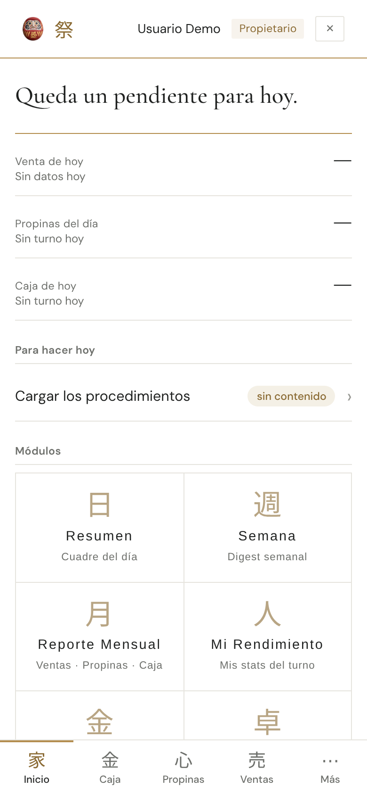
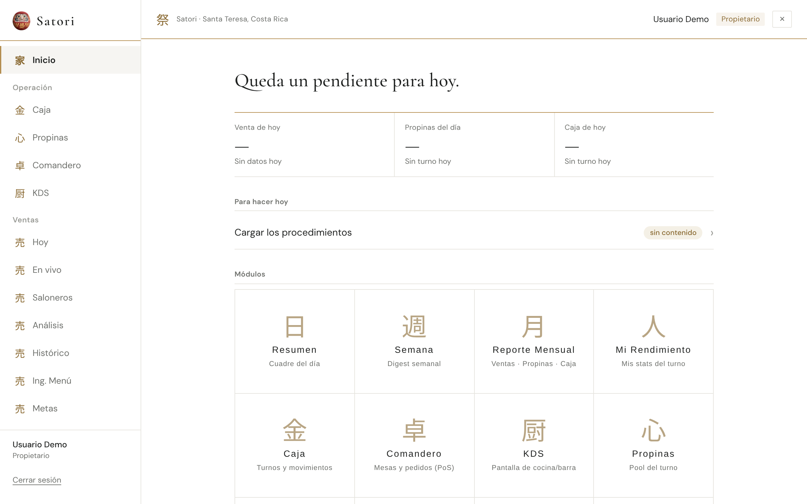
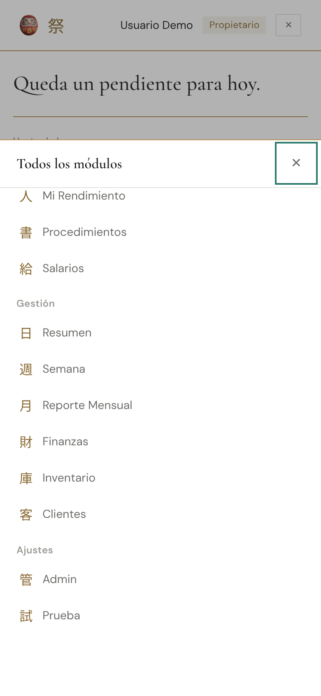

# Reporte · Línea B · B9 · Hoja «Más» con foco atrapado, monospace del CSS y un solo Daruma en el Inicio

- **PR:** [#134](https://github.com/CachoSatori/satori-app/pull/134) → `staging` (rama `claude/rediseno-b9`). Sin FIRMA. No mergeado.
- **Vista previa:** https://claude-rediseno-b9.satori-staging.pages.dev/

## Qué se hizo
- **Hoja «Más» (auditoría 202)** en `src/shared/layout/AppShell.tsx`: el mismo `keydown` que ya manejaba Escape ahora atrapa Tab. Toma los enfocables de la hoja (`a[href]`, `button:not([disabled])`); desde el último, Tab va al primero («Cerrar»); desde el primero, Shift+Tab va al último; si el foco quedó afuera de la hoja, Tab lo trae al primero (y Shift+Tab al último). En el medio no se intercepta. Se mantiene B6: `aria-modal`, foco a «Cerrar» al abrir, Escape cierra y el foco vuelve a «Más».
- **Test de render** nuevo en `AppShell.render.test.tsx`: último → primero, primero → último con Shift, Tab del medio no interceptado y foco de afuera traído adentro.
- **Auditoría 205 (parte B)** en `src/index.css`: las 4 `font-family: var(--font-mono, …monospace)` → `var(--font-sans)` + `font-variant-numeric: tabular-nums`:
  - `.sop-code` (existe también en `main`);
  - `.fx-fecha`, `.fx-marca`, `.fx-horas`: **bloque que solo existe en `staging`** — para el pase, el hunk de esas tres se descarta junto con el resto de `.fx-*` (condición 5 del PLAN).
  - Ya no queda `monospace` en el CSS del build (`grep -c monospace dist/assets/index-*.css` = 0).
- **Un solo Daruma en el Inicio en computadora:** vuelve `@media (min-width: 1024px) { .header-daruma { display: none; } }`. Verificado en el navegador: `display: block` a 390 px, `none` a 1280 px.
- **Guía 6.1:** Daruma del encabezado solo en celular y el Tab dentro de la hoja «Más». `verificado_en_commit` → `403bfdb`.

## Gates
| Gate | Resultado |
|---|---|
| `set -o pipefail; VITE_APP_ENV=production npm run build` | ✅ exit 0 |
| `npm test` | ✅ 2395 pasan, 8 omitidos. Falla solo `pos-bridge/backfill.test.ts` (falta `mssql`; igual en `staging`). Corrido con `VITE_SUPABASE_URL`/`VITE_SUPABASE_ANON_KEY` ficticias, como en B8 |
| `grep` de diagnósticos en `dist/` | ✅ vacío |
| `git diff origin/staging --stat` de `cashUtils.ts` y `tipCalculations.ts` | ✅ vacío |
| Archivos del diff | `src/index.css`, `src/shared/layout/AppShell.tsx`, `AppShell.render.test.tsx`, guía 6.1. Ninguna consulta, permiso ni ruta; nada en `src/modules/**` |

## Capturas (build local de prod + `vite preview`, backend simulado, «Usuario Demo» ficticio, sin datos)
- **Inicio 390:**  — Daruma en la barra de arriba, como antes.
- **Inicio 1280:**  — un solo Daruma (el del menú); la barra de arriba arranca con el 祭.
- **Hoja «Más» abierta, 390:**  — tomada después de llevar el foco al último ítem («Prueba») y apretar Tab: el foco quedó en «Cerrar» (recuadro verde). En Playwright con teclado real: 25 enfocables, foco tras Tab desde el último = «Cerrar».
- **Hoja «Más» a 1280:** no existe (desde 1024 px el menú es lateral y la hoja está oculta), así que no hay captura.

## Qué va a ver el encargado
- **En computadora, en el Inicio:** un solo Daruma, arriba a la izquierda en el menú. Ya no se repite en la barra de arriba.
- **En celular:** igual que hoy.
- **Con teclado** (tablet con teclado o computadora angosta): con «Más» abierto, Tab da la vuelta dentro de la lista y no se escapa a la pantalla de atrás.
- **SOPs y Salarios:** el código del documento (ej. «SOP-01») y las fechas/horas de Salarios pasan de letra de máquina a la letra normal con números alineados.

## Dudas
- Ninguna que frene. Solo el aviso del pase: los tres hunks `.fx-*` de `index.css` no existen en `main`.
