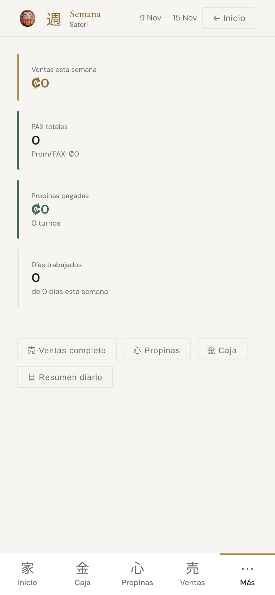
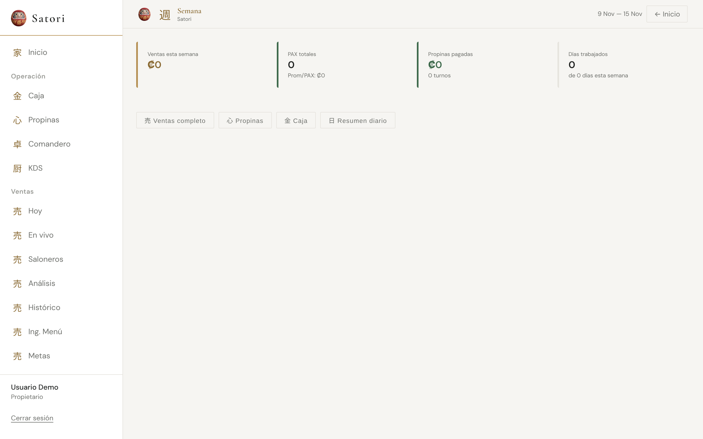
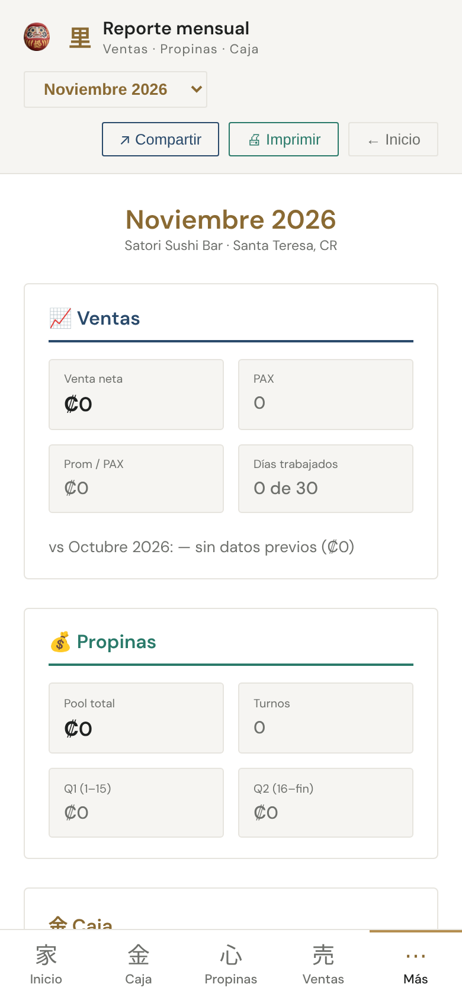
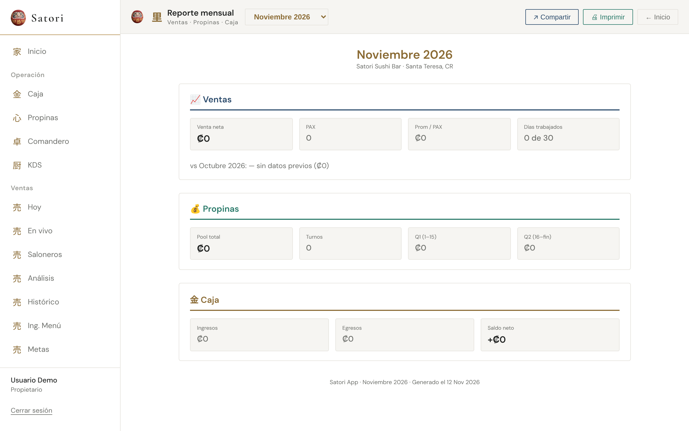
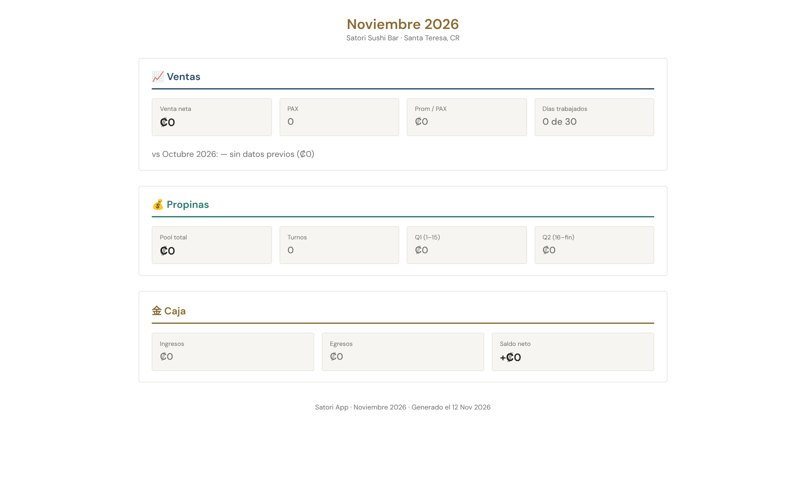

# Línea A · A11 · Daruma en Semana y Reporte mensual

- **PR:** [#135](https://github.com/CachoSatori/satori-app/pull/135) (`claude/rediseno-A11` → `staging`), sin mergear. No lleva firma.
- **Vista previa:** `https://claude-rediseno-a11.satori-staging.pages.dev`

## Qué se hizo
- `src/modules/resumen/ResumenSemanal.tsx` y `src/modules/resumen/ReporteMensual.tsx`: un `` a la izquierda del kanji (週 / 里), como en el login de B8.
- Tamaño 22×24, igual que `.module-header-left::before`. Separación hasta el kanji de 1rem, como el `gap` de `.module-header-left`: se suma un `marginRight` al `gap` que ya tenía cada contenedor (0.75rem + 0.25rem / 0.6rem + 0.4rem). No se tocó ningún `gap` existente.
- En Reporte mensual va dentro de la barra `no-print`: **no sale al imprimir** (captura con `media: print` abajo).
- Diff: +2 líneas por archivo (`` + comentario). Ningún cálculo, condición, `onClick`, consulta, permiso ni ruta.

## Gates
| Gate | Resultado |
|---|---|
| `set -o pipefail; VITE_APP_ENV=production npm run build` | ✅ exit 0 |
| `npm test` | ✅ 2394 pasan, 8 omitidos. Falla solo `pos-bridge/backfill.test.ts` (falta `mssql`; igual en `staging`). Corrido con variables de Supabase ficticias: sin ellas, 5 suites más revientan al importar `supabase.ts` (clon fresco, igual en `staging`) |
| `grep` de diagnósticos en `dist/` | ✅ vacío |
| `git diff origin/staging --stat` de `cashUtils.ts` y `tipCalculations.ts` | ✅ vacío |
| Archivos del diff | Solo los dos de `src/modules/resumen/` (línea A) |

## Qué va a ver el encargado
- En **Semana** y **Reporte mensual**, arriba a la izquierda, el Daruma chico al lado de la letra, igual que en Caja, Ventas o Resumen.
- Al imprimir o sacar el PDF del Reporte mensual, todo queda igual que hoy.

## Capturas (build local de prod, backend simulado, usuario «Usuario Demo» ficticio, sin datos)
- **Semana:**  
- **Reporte mensual:**  
- **Reporte mensual al imprimir** (sin Daruma): 

## Guía
- No se actualiza la 6.4: el Daruma es decorativo y no cambia nada que la guía nombre. Está dicho en el PR.

## Dudas
- Las capturas van en `reportes/img/` junto al reporte, como hizo B8.
