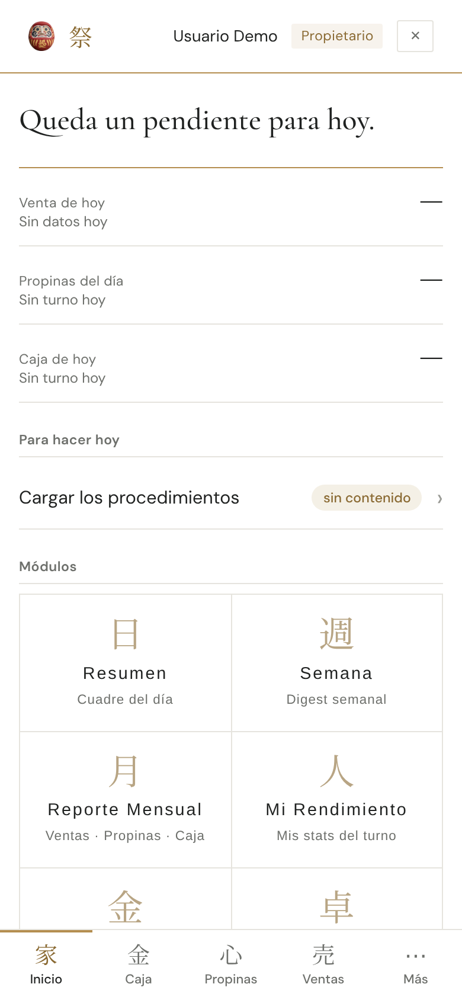
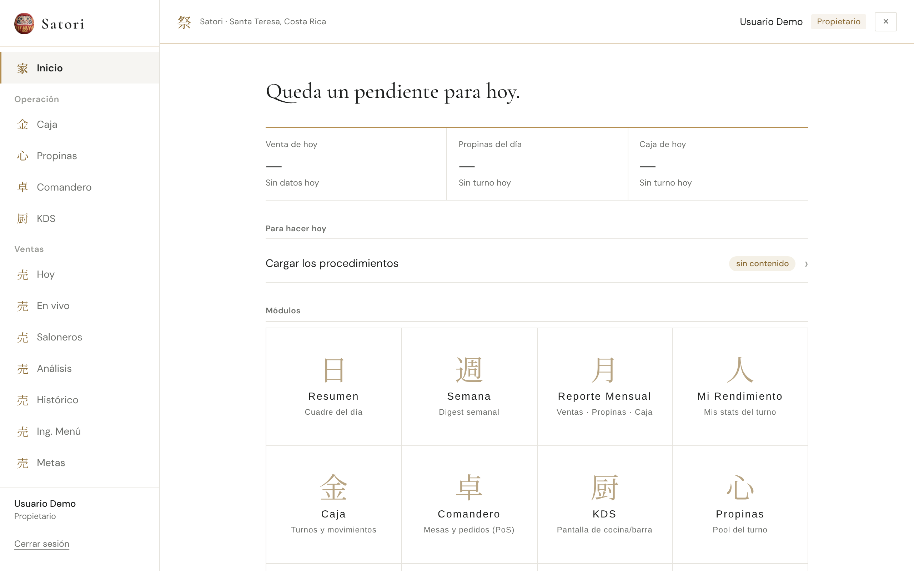
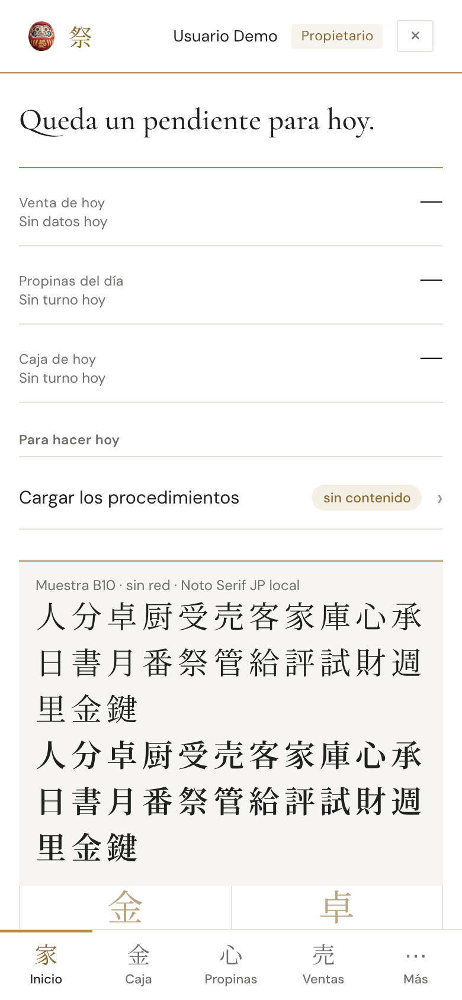
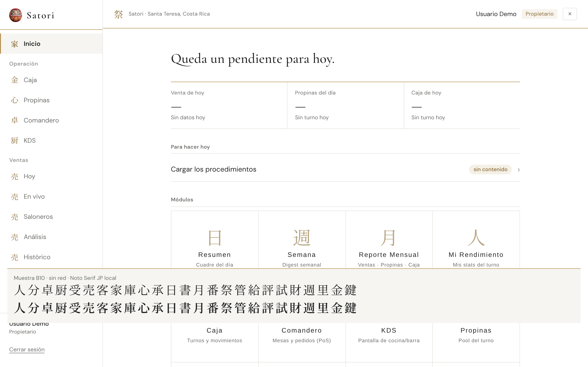

# Reporte · Línea B · B10 · Kanji sin internet (auditoría 206)

- **PR:** [#137](https://github.com/CachoSatori/satori-app/pull/137) → `staging` (rama `claude/rediseno-b10`, commit `85bbe95`). Sin FIRMA. No mergeado.
- **Vista previa:** https://claude-rediseno-b10.satori-staging.pages.dev/

## Qué se hizo
- **Noto Serif JP servida desde `public/fonts/`**, recortada a los kanji que usa la app, en dos pesos (400 y 600, los mismos que se pedían a Google):
  - `noto-serif-jp-kanji-400-normal.woff2` — **6,6 KB**;
  - `noto-serif-jp-kanji-600-normal.woff2` — **6,6 KB**;
  - licencia `OFL-noto-serif-jp.txt` (SIL OFL 1.1).
- **`src/index.css`:** dos `@font-face` con `unicode-range` de solo esos caracteres (el navegador baja el archivo solo si la pantalla tiene un kanji). **Se sacó el `@import` de Google** de Noto Serif JP; ya no queda ningún `googleapis` en el CSS global.
- **Guía 6.1:** la línea de «las letras vienen con la app» ahora incluye los kanji; `verificado_en_commit` → `2e1f73c`.

### Caracteres incluidos (25)
`人分卓厨受売客家庫心承日書月番祭管給評試財週里金鍵`

Juntados de todo `src/**` (`.ts`, `.tsx`, `.css`, sin tests) e `index.html`: `modulos.ts`, `loading-mark`/encabezados de módulos, `AppShell` (家), `App.tsx` (承, 祭), `HomePage`, `useAuth`, `CambiarPasswordInicial` (鍵). `LoginPage` ya no tiene kanji (B8 lo pasó al Daruma).

### Cómo regenerarla si se agrega un kanji
Está también en el comentario de `src/index.css`:
1. Bajar `NotoSerifJP[wght].ttf` de `google/fonts` (`ofl/notoserifjp`).
2. `fonttools varLib.instancer NotoSerifJP[wght].ttf wght=400 --update-name-table -o i400.ttf` (y lo mismo con 600).
3. `pyftsubset i400.ttf --text="<lista con el kanji nuevo>" --flavor=woff2 --layout-features='' --no-hinting --desubroutinize --name-IDs='*' --output-file=public/fonts/noto-serif-jp-kanji-400-normal.woff2` (y lo mismo con 600; hace falta `pip install fonttools brotli`).
4. Agregar el código del kanji (`U+XXXX`) al `unicode-range` de los dos `@font-face`.

Sin esto, un kanji nuevo cae en la serif del sistema (no se rompe nada, solo se ve distinto).

## Gates
| Gate | Resultado |
|---|---|
| `set -o pipefail; VITE_APP_ENV=production npm run build` | ✅ exit 0 |
| `npm test` | ✅ 2416 pasan, 8 omitidos, 0 fallan. Con `VITE_SUPABASE_URL`/`VITE_SUPABASE_ANON_KEY` ficticias y `npm ci` en `pos-bridge/` (`mssql`) |
| `grep` de diagnósticos en `dist/` | ✅ vacío |
| `git diff origin/staging --stat` de `cashUtils.ts` y `tipCalculations.ts` | ✅ vacío |
| Archivos del diff | `src/index.css`, 3 archivos nuevos en `public/fonts/`, guía 6.1. Nada en `src/modules/**`, consultas, permisos, rutas, `vite.config.ts` ni SW |

## Verificación sin internet
- En el build, la URL queda reescrita con la base de producción: `url(/satori-app/fonts/noto-serif-jp-kanji-400-normal.woff2)`.
- **Precache:** los dos `woff2` nuevos aparecen en `dist/sw.js` sin tocar nada (el patrón `**/*.woff2` ya existía).
- **Playwright** sobre `vite preview` (backend simulado, «Usuario Demo» ficticio): primera carga, se espera el service worker, se corta la red (`setOffline`) y se recarga. Con la red cortada, Chrome dibuja los kanji con la fuente propia: `NotoSerifJP-Regular` (400) y `NotoSerifJP-SemiBold` (600), 25 glifos. Los kanji del menú lateral también salen en Noto Serif JP. **Cero pedidos a Google Fonts** en toda la corrida (se bloqueaba todo lo externo y no hubo ninguno).

## Capturas (sin datos reales)
- **Inicio 390:** 
- **Inicio 1280:**  — kanji del menú y de la grilla en Noto Serif JP local.
- **Sin red, 390:**  — el recuadro gris «Muestra B10» es un agregado de la prueba (no es parte de la app): los 25 kanji en 400 y en 600, dibujados con la red cortada.
- **Sin red, 1280:** 

## Qué va a ver el encargado
- **Con internet:** lo mismo que hoy. Los kanji del menú, de la barra de abajo y de los encabezados se ven igual.
- **Sin internet** (después de haber abierto la app una vez): los kanji ya no cambian a otra letra; se ven con la misma letra que con internet.
- La app hace un pedido menos a Google al abrir.

## Dudas
- Ninguna que frene.
- **Para la línea A (no tocado):** `src/modules/salarios/salarios.css` todavía trae Fraunces, Hanken Grotesk y JetBrains Mono desde Google (`@import`). Es solo de Salarios, que no tiene ruta en `main`.
- `--font-sans` sigue nombrando `'Noto Sans JP'`, que nunca se cargó; si un kanji cae en un elemento con letra sans, usa la del sistema. Hoy todos los kanji de la cáscara usan `--font-serif`.
